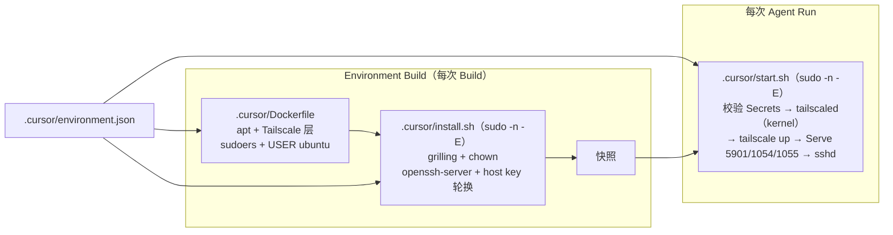
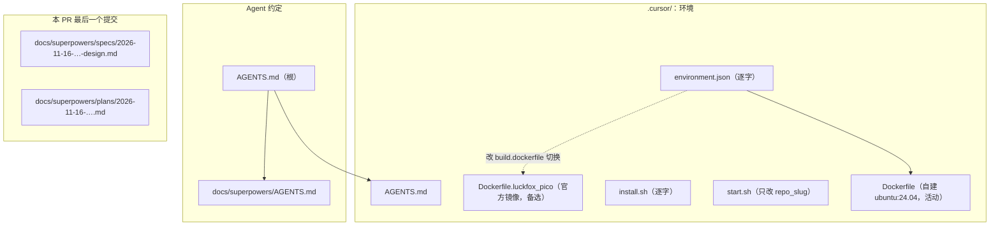
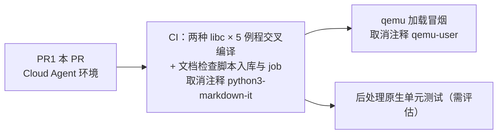

# Luckfox Pico RKMPI Example — Cloud Agent 环境设计规格

- **日期**：2026-11-16
- **状态**：已落地，V1–V4 本机验证通过，V5、V6 待作者在 Cursor 中验证，验证证据见 plan
- **分支**：`pi/cloudagent-env`（起点 `origin/dev` `5517825`，与上游 `LuckfoxTECH/luckfox_pico_rkmpi_example` 的 `kernel-5.10.160` 相同），PR [#1](https://github.com/yuangezhizao/luckfox_pico_rkmpi_example/pull/1)
- **范围来源**：作者要求为本仓补充 Cursor Cloud Agent 运行所需的文件，参考 `luckfox_pico_lvgl_example`（下称 lvgl 仓）的实现（见下一行），代码以 lvgl 仓最新 `dev` 为准；作者要求与 lvgl 仓对齐（Q1–Q3）
- **参考实现**：lvgl 仓 [`dev` `11497f3`](https://github.com/yuangezhizao/luckfox_pico_lvgl_example/tree/11497f3d57d1e74eeade30a07e79a19c0f7f2369)（PR #17 合入）。按 `dev` 的合并记录，被移植的文件来自：两份 Dockerfile——PR [#1](https://github.com/yuangezhizao/luckfox_pico_lvgl_example/pull/1)（配置即代码）、[#2](https://github.com/yuangezhizao/luckfox_pico_lvgl_example/pull/2)（补装 `curl`）、[#7](https://github.com/yuangezhizao/luckfox_pico_lvgl_example/pull/7)（`qemu-user`）、[#9](https://github.com/yuangezhizao/luckfox_pico_lvgl_example/pull/9)（apt 补齐、Tailscale、`ubuntu` 用户）、[#14](https://github.com/yuangezhizao/luckfox_pico_lvgl_example/pull/14)（preview 工具）、[#16](https://github.com/yuangezhizao/luckfox_pico_lvgl_example/pull/16)（`python3-markdown-it`）；`environment.json`——#1、[#3](https://github.com/yuangezhizao/luckfox_pico_lvgl_example/pull/3)（grilling）、#9；`install.sh`、`start.sh`——#9；`.cursor/AGENTS.md`、`docs/superpowers/AGENTS.md`、根 `AGENTS.md`——以 [#17](https://github.com/yuangezhizao/luckfox_pico_lvgl_example/pull/17) 精简后的版本为底
- **关联计划**：[`../plans/2026-11-16-rkmpi-example-cloudagent-env.md`](../plans/2026-11-16-rkmpi-example-cloudagent-env.md)

---

## 1. 概述与目标

本仓是 Luckfox 官方的 RKMPI 例程集：5 个 RTSP 推流 / RKNN 推理例程，C++ + OpenCV-Mobile + Rockchip MPI，CMake 构建，产物是 32 位 ARM（RV1103 / RV1106），只能交叉编译。Cursor Cloud Agent 的默认镜像没有 ARM 交叉工具链，Agent 每次都要自己装；lvgl 仓已用「Dockerfile 配置即代码」解决了同样的问题，并补齐了 grilling 技能、Tailscale 与 OpenSSH 远程接入、`AGENTS.md` 约定与 spec / plan 格式规则。

目标：

1. 把 lvgl 仓 `dev` 上的 Cloud Agent 环境整套移植到本仓：两份 Dockerfile、`environment.json`、`install.sh`、`start.sh`、`.cursor/AGENTS.md`（§3.2–§3.4、Q2）。
2. Dockerfile 的 apt 清单与 lvgl 仓逐组对齐；本仓暂不需要的四组保留为注释，由以后引入相应测试的 PR 取消注释（§3.3、Q3）。
3. 新增根 `AGENTS.md` 与 `docs/superpowers/AGENTS.md`，结构与 lvgl 仓相同、内容按本仓改写（§3.5、Q1）。
4. Tailscale 主机名区分项目：`cursor-agent-for-luckfox-pico-rkmpi-example-<bcId 前 8 位>`（§3.4）。
5. 在当前 VM 的 Docker 中构建两份镜像，完成两种 libc × 5 个例程的交叉编译；平台侧验证留到作者在 Cursor 中开发下一个 PR 时（§4、Q6）。

**不在本规格范围**：测试框架、qemu 冒烟、文档检查脚本与 GitHub Actions（§7 路线图）；修改 `CMakeLists.txt`、`build.sh` 与例程源码；uClibc 工具链预装（Q4）。

## 2. 背景

### 2.1 本仓现状

| 方面 | 现状 |
|---|---|
| 构建入口 | `build.sh` 用两个 `select` 交互选择 libc 与例程，在仓库内 `build/` 中 `cmake` 后 `make install`；可用 `printf '2\n1\n' \| ./build.sh` 非交互运行，也可直接调用 `cmake -DEXAMPLE_DIR=… -DEXAMPLE_NAME=… -DLIBC_TYPE=…` |
| 工具链 | uClibc：`$LUCKFOX_SDK_PATH/tools/linux/toolchain/arm-rockchip830-linux-uclibcgnueabihf/`；glibc：`$GLIBC_COMPILER` 前缀。未设置时 `CMakeLists.txt` 打印 WARNING 后 `return()` |
| 依赖 | OpenCV-Mobile、rockit、rkaiq、rknnmrt、rga 等按 libc 预编译于 `lib/{glibc,uclibc}`（115 MB），头文件在 `include/`（11 MB），无需系统库 |
| 产物 | `CMAKE_INSTALL_PREFIX` 在 `project()` 之后用 `set()` 写死为源码树内的 `install/<libc>/<例程>_demo/`，命令行 `-DCMAKE_INSTALL_PREFIX` 无效；**而 `install/` 已入库**（55 MB），`make install` 与 `build.sh` 都会改写已跟踪的二进制。`make install DESTDIR=/tmp/stage` 只写到 `/tmp/stage/<仓库绝对路径>/install/…`，不动工作区 |
| 运行 | 只能在板上运行，需摄像头、ISP、NPU；x86 VM 上只能做加载冒烟（§2.5） |
| Agent 文件 | 无 `.cursor/`、`AGENTS.md`、`docs/`、`.github/` |

### 2.2 lvgl 仓 `dev` 的 Cloud Agent 文件



| 文件 | 来源 PR | 内容 | 本仓处理 |
|---|---|---|---|
| `.cursor/environment.json` | #1、#3、#9 | `build.dockerfile` + `install` + `start` | 逐字复用 |
| `.cursor/Dockerfile` | #1、#2、#7、#9、#14、#16 | `ubuntu:24.04` digest 锁定；apt 分组；Tailscale noble 源；免密 sudo；`safe.directory`；`USER ubuntu` | 结构与 apt 分组对齐，四组注释掉（§3.3） |
| `.cursor/Dockerfile.luckfox_pico` | 同上 | 官方镜像 `luckfoxtech/luckfox_pico:1.0` 备选 | 保留，处理同上（Q2） |
| `.cursor/install.sh` | #9（grilling 来自 #3 的 `install`） | grilling `85f83d3` + `openssh-server` + host key 一次性轮换 | 逐字复用 |
| `.cursor/start.sh` | #9 | Secrets 门禁、Tailscale kernel 模式、Serve、sshd | 只改 `repo_slug` |
| `.cursor/AGENTS.md` | PR #17 拆出 | 环境说明与 gotcha | 改写为本仓内容（§3.5） |
| 根 `AGENTS.md` | #1 起，PR #17 精简 | 交互约定、构建、测试、提交约定、去向表、`Cursor Cloud specific instructions` | 新增，结构对齐（Q1、Q8） |
| `docs/superpowers/AGENTS.md` | PR #17 拆出 | spec / plan 格式规则 | 新增，「检查」一条改写（Q7） |

lvgl 仓工作区中作者未提交的 `.cursor/install.sh`（rtk）、`.cursor/start.sh`（tmux extended-keys）改动不在 `dev` 上，按作者「以最新 `dev` 为准」的要求不移植。

### 2.3 实测：当前 VM 的交叉编译（2026-11-16）

在本 VM（lvgl 仓的 Cloud Agent 镜像，`arm-linux-gnueabihf-gcc` 13.3.0；uClibc 工具链为稀疏检出的 `yuangezhizao/luckfox-pico` `c3ef271`）对仓库副本逐个执行 `cmake -S . -B <dir> -DEXAMPLE_DIR=example/<例程> -DEXAMPLE_NAME=<例程> -DLIBC_TYPE=<libc>` 与 `make install`：

- glibc、uClibc 各 5 个例程，10 个全部成功，编译输出没有 `warning:`。
- glibc 产物需要的最高符号版本为 `GLIBC_2.34`，与仓库中已提交的二进制（GCC 11.3.1 编译）相同。
- `git status` 显示 `install/` 下 10 个已跟踪二进制被改写；改用 `DESTDIR` 后工作区无改动（§2.1）。

### 2.4 包的现状（2026-11-16 复核，Q5）

- **平台 Aptfile**：本 VM 的 `/usr/local/share/vnc-desktop.Aptfile` sha256 为 `819987b7fef06af920bd9313347e05ca2fb0cd32ab4ad1e32a2a045238e4abb8`，58 个包，与 lvgl 仓 2026-10-06 的复核相同，Dockerfile 注释框照用并改写复核日期。
- **两个 FROM**：对 lvgl 仓锁定的同一 digest 执行 `docker run --rm --entrypoint dpkg-query <镜像> -W -f '${db:Status-Abbrev} ${Package}\n'`，只计 `ii`：`ubuntu:24.04@sha256:4fbb8e6a…` 92 个，`luckfoxtech/luckfox_pico:1.0@sha256:915d4458…` 366 个，与 lvgl 仓记录的数量相同。逐个核对 lvgl 仓 apt 清单中的 41 个包：

| 包 | `ubuntu:24.04` | `luckfox_pico:1.0` |
|---|---|---|
| `ca-certificates` `git` `cmake` `pkg-config` `file` `openssh-client` `openssl` `rsync` `unzip` `vim` `wget` `xz-utils` | 不在 | 已在 |
| 其余 29 个（`sudo` `curl` 交叉工具链 `build-essential` `libcjson-dev` `libdrm-dev` `libsdl2-dev` `qemu-user` `imagemagick` `xdotool` `xvfb` `python3-markdown-it` `iproute2` `jq` B 类 15 个 `locales`） | 不在 | 不在 |

结论与 lvgl 仓两份 Dockerfile 的「不在 FROM 才写」完全一致，apt 行无需调整。`openssh-server` 不在 `ubuntu:24.04`、已在 `luckfox_pico:1.0`，与 lvgl 仓注释相同。

### 2.5 本仓能做哪些测试（作者在 Q3 中提问）

lvgl 仓的做法是 apt 包随使用它的 PR 加入：`libsdl2-dev`、`libcjson-dev`、`libdrm-dev` 在 PR #1（native 渲染演示），`qemu-user` 在 PR #7（原生测试：32 位换算测试与 uClibc 产物冒烟），`imagemagick`、`xvfb` 在 PR #14（preview 脚本），`python3-markdown-it` 在 PR #16（文档检查）；CI 是 PR #4。本仓情况：

| lvgl 仓的测试 | 本仓可行性 | 依据 |
|---|---|---|
| 交叉编译（CI） | 可行 | §2.3，两种 libc × 5 个例程 |
| qemu 冒烟 | 可做「加载冒烟」 | `qemu-arm -L /usr/arm-linux-gnueabihf` 运行 glibc 产物：所有 `.so` 解析成功、进入 `main()`，随后因 `RkLunch-stop.sh` 不存在、打不开模型或设备而 `abort`。只能证明链接与加载，不能证明功能 |
| 原生单元测试 | 可能可行，需评估 | 例程中的后处理（yolov5 / retinaface 的框解码、NMS）是纯计算，可用主机 gcc 编译；摄像头、rockit、RKNN 调用要打桩 |
| native 渲染、preview 截图 | 不适用 | 本仓没有 GUI，输出是 RTSP 视频流 |
| 文档检查 | 可行 | 脚本照搬 lvgl 仓 `tests/tools/docs/`，要改 `QA_EXEMPT` |

结论：测试与 CI 都不放在本 PR（§7）。

### 2.6 官方文档的变化

Cursor 文档 [Cloud Environment Setup](https://cursor.com/docs/cloud-agent/setup)（2026-11-16 读取）的「Environment resolution order」已改为：个人 saved environment → 团队 saved environment → 仓库 `.cursor/environment.json`（仅单仓 Run）；saved environment 只有在 **environment.json location** 指向该文件时才读取它，新建的 environment 默认是 **None (skip environment.json)**。为一个还没有 saved environment 的单仓首次启动 Agent 时，平台检查仓库中的 `.cursor/environment.json`，有效则把 location 指向它。

- 作者确认本 fork 在 Dashboard 中还没有 saved environment（Q6），合并后首次启动 Agent 即可自动指向该文件（§6）。
- lvgl 仓 `.cursor/AGENTS.md` 中「repo 级 `.cursor/environment.json` 优先于 personal / team saved environment」已过时，本仓按新文档写，lvgl 仓的更正列为后续（§7）。
- 文档 [Cloud Agent Builds](https://cursor.com/docs/cloud-agent/builds)：Build 使用默认分支（本 fork 为 `dev`）的配置；用户级 Secrets 只在 Agent 启动时注入，Build 期不可用——与 `start.sh` 读取 `TAILSCALE_AUTHKEY`、`SSH_AUTHORIZED_KEYS` 的做法一致。
- 官方建议 Dockerfile 设置 `USER ubuntu` 与 `WORKDIR /home/ubuntu`；lvgl 仓未设 `WORKDIR`，本仓沿用（我的判断：`install` 在项目根运行，`WORKDIR` 不影响 Agent）。

## 3. 设计（以 §8 QA 结论为准）

### 3.1 是否建议补充

建议。理由：

- 默认镜像没有 `gcc-arm-linux-gnueabihf` 与 `cmake`，不配置时每个 Agent 都要现装，且 Agent 使用的版本不可复现。
- 环境与 lvgl 仓同构后，同一套 Secrets、Tailscale 主机名规则与 SSH 接入可直接复用，两仓的 Dockerfile 可以对照维护。
- 改动只新增文件，不碰构建脚本与源码，同步上游时不会冲突。

作者最初判断「只包含 `.cursor` 文件夹」：就环境本身而言成立；为与 lvgl 仓对齐，作者选择同时新增根 `AGENTS.md` 与 `docs/superpowers/AGENTS.md`（Q1）。

### 3.2 新增文件



### 3.3 Dockerfile 的 apt 清单（Q3）

两份 Dockerfile 都以 lvgl 仓 `dev` 的对应文件为底：FROM digest、分组与顺序、Tailscale 层、sudoers、`safe.directory`、`ENV TZ`、`USER ubuntu` 不变。apt 清单逐组对齐，本仓暂不需要的四组把包行改为注释，组名注释后标明「本仓暂不安装」：

| 分组 | 包 | 本仓 | 说明 |
|---|---|---|---|
| 基础工具 | `ca-certificates` `git` `sudo`（备选只写 `sudo`） | 安装 | 同 lvgl |
| 平台引导 | `curl` | 安装 | exec-daemon 安装需要（lvgl 仓 PR #2） |
| ARM 交叉工具链 | `gcc-arm-linux-gnueabihf` `g++-arm-linux-gnueabihf` | 安装 | glibc 构建 |
| 构建系统 | `build-essential` `cmake`（备选只写 `build-essential`） | 安装 | `make`；`cmake_minimum_required(VERSION 3.10)` |
| native 验证 | `libcjson-dev` `libdrm-dev` `libsdl2-dev` `pkg-config`（备选不含 `pkg-config`） | 注释 | 本仓无 native 构建，依赖已预编译于 `lib/` |
| 32 位运行 | `qemu-user` | 注释 | 加载冒烟属后续 PR（§2.5） |
| preview 工具 | `imagemagick` `xdotool` `xvfb` | 注释 | 本仓无 GUI |
| 文档检查 | `python3-markdown-it` | 注释 | 检查脚本随 CI PR 入库（Q7） |
| A 类 | `iproute2` `jq` | 安装 | `start.sh` 依赖 |
| B 类 | 诊断 CLI 15 个 | 安装 | 同 lvgl |
| C 类 | 通用 CLI（备选只写 `locales`） | 安装 | 同 lvgl |

注释写法（我的判断）：每个注释组的原因写在 RUN 上方的分组说明中，组名后只标「本仓暂不安装」。RUN 续行中以 `#` 开头的行在 Dockerfile 解析时整行删除，被注释的包行保留末尾的 `\` 也不影响续行；本 VM 以小样例验证，`docker build --check` 无告警、构建只执行了未注释的部分。

```dockerfile
      # native 验证（本仓暂不安装，原因见上方说明）
      # libcjson-dev libdrm-dev libsdl2-dev pkg-config \
```

注释文字（Q5）：结构与 lvgl 仓相同（头部说明、平台 Aptfile 清单框、apt 分组说明）。头部改写为本仓（无 native 渲染、`build.sh` 存在、`install/` 入库），lvgl spec 的引用改为本 spec 或说明出处为 lvgl 仓；四个注释组的说明改为「本仓暂不安装」并写明原因；复核日期改为 2026-11-16（§2.4）。

### 3.4 `environment.json`、`install.sh`、`start.sh`

- `environment.json`、`install.sh` 与 lvgl 仓 `dev` 逐字相同。
- `start.sh` 只改 `repo_slug="luckfox-pico-rkmpi-example"`；主机名 `cursor-agent-for-luckfox-pico-rkmpi-example-xxxxxxxx` 共 52 字节，不超过 DNS 标签的 63 字节。
- Secrets `TAILSCALE_AUTHKEY`、`SSH_AUTHORIZED_KEYS` 为用户级，与 lvgl 仓、luckfox-pico 仓共用，无需新建。

### 3.5 三份 `AGENTS.md`（Q1、Q7–Q9）

- **`.cursor/AGENTS.md`**：按 lvgl 仓条目改写：当前活动 / 备选 Dockerfile（含「注释组」的说明）、resolution order（按 §2.6）、grilling、用户与远程接入（主机名改为本仓）、规则缓存、核对镜像内容；CI 一条改为「本仓暂无 CI」。
- **根 `AGENTS.md`**：章节与 lvgl 仓相同；「项目与构建」「测试与检查」「去向表」按本仓重写，其余各节（交互约定、优先级、提交约定、`Cursor Cloud specific instructions`）基本照搬，只删去不存在的文件与 CI。
  - 项目与构建（Q9）：两种 libc 的工具链取法（uClibc 稀疏检出命令同 lvgl 仓）；推荐在仓库外构建目录中 `cmake` + `make`，需要部署目录时 `make install DESTDIR=/tmp/stage`；`install/` 已入库，只在作者要求更新发布产物时改写，误改用 `git restore install/` 还原；`build.sh` 会改写 `install/`；x86 上无法运行例程。
  - 不写会过时的数字（Q10）：uClibc 工具链只写稀疏检出命令，不写体积。
  - 体积预算（Q11）：去向表写明本文件不超过 8 KiB，沿用 lvgl 仓的仓库内预算；本仓暂无 CI，先是文字约定。
  - 提交约定（作者审阅 spec 与 plan 时补充）：正文写成「- 」开头的要点，与 lvgl 仓近期提交一致；本仓是 fork，裸 `#N` 会被 GitHub 解析到本 fork 或上游，PR、issue 一律写完整链接或 `owner/repo#N`；`Cursor Cloud specific instructions` 写明 `gh pr create` 要加 `-R yuangezhizao/luckfox_pico_rkmpi_example --base dev`。
  - 测试与检查（Q8）：暂无测试与 CI；按改动范围选检查：改 shell 脚本跑 ShellCheck，改 `CMakeLists.txt`、`lib/`、例程跑两种 libc 的交叉编译，只改文档按 `docs/superpowers/AGENTS.md` 检查。
- **`docs/superpowers/AGENTS.md`**：标题编号、Task、附录与 QA 三条照搬（删去 lvgl 仓的 6 份豁免说明）；「检查」一条写明脚本尚未入库，开发时用 lvgl 仓 `tests/tools/docs/check-headings.py` 手动检查，脚本随 CI PR 入库（Q7）；删去指向 lvgl 仓历史 spec 的一条。

### 3.6 不做的事

- 不改 `CMakeLists.txt`、`build.sh`、例程与 `lib/`、`install/`。
- 不新增测试、CI、文档检查脚本；不预装 uClibc 工具链（Q4）。
- 不移植 lvgl 仓工作区中未提交的 rtk、tmux 改动（§2.2）。

## 4. 验证（Q6）

本 PR 只做 V1–V4，在当前 VM（pi）完成：

| 编号 | 验证 | 方式 |
|---|---|---|
| V1 | 静态检查 | `environment.json`、`install.sh` 与 lvgl 仓逐字比对；`start.sh` 与 lvgl 仓只差 `repo_slug` 一行；两份 Dockerfile 与 lvgl 仓的 diff 只有注释与注释掉的包行；`shellcheck` 0 条；spec、plan 用 lvgl 仓 `check-headings.py` 检查为 0 |
| V2 | 镜像 | 本 VM 已有 Docker；`docker build --check` 无告警，两份镜像构建成功；默认用户 `ubuntu`（备选 uid 由 `useradd` 创建），`sudo -n` 可用；apt 集合与 §3.3 一致 |
| V3 | 容器内交叉编译 | 两份镜像中以 `ubuntu` 身份构建 glibc 5 个例程；稀疏检出 uClibc 工具链后构建 5 个例程；`readelf` 为 ELF32 ARM；用 `DESTDIR` 或仓库副本，不改工作区 |
| V4 | `install.sh` | 容器内运行两次，grilling 属主 `ubuntu`，host key 第二次不变 |

V5（草稿 Environment Build）、V6（冷启动 Agent、tailnet SSH）由作者在 Cursor 中开发下一个 PR 时验证，plan 中写明步骤与核对项，不在本 PR 记为通过。

## 5. 提交与 PR

- 分支 `pi/cloudagent-env`，PR 指向 fork 的 `dev`，开发期为草稿，合并前准备完成后改为 ready；先推送 spec、plan。
- 提交：
  1. `chore(cloud-env): 🐳 新增 Cloud Agent 的两份 Dockerfile`：`.cursor/Dockerfile`、`.cursor/Dockerfile.luckfox_pico`。
  2. `feat(cloud-env): ✨ 新增 environment.json 与 install、start 脚本`：grilling、Tailscale、OpenSSH。
  3. `docs(agents): 📝 新增根 AGENTS.md 与 .cursor/AGENTS.md`。
  4. `docs(superpowers): 📝 新增 spec 与 plan 的格式规则`：`docs/superpowers/AGENTS.md`。
  5. `docs(superpowers): 📝 新增 Cloud Agent 环境 spec 与 plan`：最后一个提交；开发期最先推送，最终用 rebase 移到末尾。
- 合并前精简 plan（已完成），只保留未入库的内容：验证证据、偏离、V5/V6 步骤，以及附录 A 中可供以后参考的命令与脚本（包的复核、现状实测与 qemu 加载冒烟、提交整理）。

## 6. 风险

- 合并前不要在 Cursor 中为本 fork 启动 Cloud Agent：首次启动会创建 saved environment，若此时默认分支 `dev` 还没有 `.cursor/environment.json`，location 会是 None，合并后也不读取该文件（§2.6）；若已发生，在 Dashboard 把 location 改为指向该文件。
- `make install` 与 `build.sh` 改写已入库的 `install/`，Agent 验证构建时容易误提交二进制（§2.1），根 `AGENTS.md` 写明（Q9）。
- Tailscale apt 源不锁版本，镜像随时间变化（与 lvgl 仓相同的取舍）。
- tailnet 端口暴露沿用 luckfox-pico 仓 [08-30 spec](https://github.com/yuangezhizao/luckfox-pico/blob/665c7f10a132718ea2b9cb5fa25670c5197c9aba/docs/superpowers/specs/2026-08-30-luckfox-cloudagent-tailscale-design.md) §2.8 与 lvgl 仓 spec §7 的接受范围：不配 Tailscale ACL；1054/1055 经 Serve 可被获准连接本节点的 tailnet 设备当作 Agent 的网络代理。Codex 安全审查对此提出 P2，按同一取舍不修改（[回复](https://github.com/yuangezhizao/luckfox_pico_rkmpi_example/pull/1#discussion_r4587552920)）；收紧访问时三仓一起补 ACL / grants。
- V5、V6 推迟，平台侧问题（如 Build 期 `install.sh` 失败）要到下一个 PR 才会暴露；两份文件与 lvgl 仓逐字相同，风险较低。

## 7. 后续（路线图）

参照 lvgl 仓的顺序，每项单独一个 PR，apt 包在使用它的 PR 中取消注释：



- V5、V6 平台验证：作者在 Cursor 中开发下一个 PR 时进行。
- lvgl 仓 `.cursor/AGENTS.md` 的 resolution order 按 §2.6 更正；lvgl 仓根 `AGENTS.md` 删去「约 233 MB」（Q10）。两项都在 lvgl 仓 PR #17 下留了[评论](https://github.com/yuangezhizao/luckfox_pico_lvgl_example/pull/17#issuecomment-6919060613)，避免遗漏。
- uClibc 工具链在 Build 期预装，两仓一起做（Q4）。

## 8. QA（grilling 记录）

问句与推荐取自问答原文，「答」是作者回答经润色后的版本。第 1 轮 6 问（Q1–Q6）；第 2 轮 3 问（Q7–Q9）；实现后作者另问两点，记为 Q10、Q11。

**Q1. PR 范围：只有 `.cursor/`，还是同时新增 `AGENTS.md`**

- 问：A 只新增 `.cursor/` 5 个文件；B 再加根 `AGENTS.md`（交互约定、构建、提交约定、`Cursor Cloud specific instructions`）；C 在 B 之外再加 `docs/superpowers/AGENTS.md`（spec / plan 格式规则）。
- 推荐：B。Cursor 官方建议 Cloud 专用说明放在根 `AGENTS.md`；C 的格式规则依赖 lvgl 仓的检查脚本，等有第二份 spec 时再加。
- 答：C，与 lvgl 仓对齐，一开始就补齐 `docs/superpowers/AGENTS.md`。可行：格式规则本身不依赖脚本，只有「检查」一条要改写（Q7）（§3.5）。

**Q2. 是否保留官方镜像备选 `Dockerfile.luckfox_pico`**

- 问：A 只保留自建 `ubuntu:24.04`；B 与 lvgl 仓一样保留备选。
- 推荐：A。lvgl 仓 PR #1 已结论备选没有实质构建收益，仅为对齐参考项目；保留则每次改 apt 都要改两份文件、验证两份镜像。
- 答：B，保留两份镜像（§3.2、§3.3）。

**Q3. apt 包集合**

- 问：按本仓需要删去 native 验证、qemu、preview、文档检查四组；还是完全照搬 lvgl 仓。
- 推荐：删减。四组都只服务 lvgl 仓的测试与脚本；两仓 FROM 相同，删减后仍按同样的分组与顺序。
- 答：先完全照搬 lvgl 仓，不需要的包注释掉而不删除。作者另问本仓能否做测试、qemu 与 preview 能否运行、测试框架是否放在本 PR：注释写法可行（§3.3）；可行性见 §2.5，测试按 lvgl 仓的做法放到后续 PR，届时取消注释（§7）。

**Q4. uClibc 工具链**

- 问：A 与 lvgl 仓相同，不预装，`AGENTS.md` 写稀疏检出命令（约 233 MB）；B `install.sh` 在 Build 期稀疏检出到固定目录（如 `/opt/luckfox-pico`，锁定提交），并通过 `/etc/profile.d` 设置 `LUCKFOX_SDK_PATH`；C 写进 Dockerfile 的一层。
- 推荐：A。lvgl 仓 PR #9 spec Q1 已把预装列为两仓一起做的后续项；B、C 都会让 Build 依赖 GitHub 大体积下载，且要决定锁定哪个提交。
- 答：按推荐（§3.6、§7）。

**Q5. Dockerfile 注释写法**

- 问：A 结构与 lvgl 仓相同（头部说明、平台 Aptfile 清单框、apt 分组说明），内容改写为本仓并引用本 spec；B 只保留每组一行的说明，删去平台 Aptfile 清单框与历史引用。
- 推荐：A。两仓文件结构相同，日后同步改动可直接对照；平台 Aptfile 清单框记录了平台会额外安装的包，排查时有用。
- 答：按推荐，并要求重新查询当前环境中各个包是否存在。已复核平台 Aptfile 与两个 FROM 的 dpkg，结论不变（§2.4、§3.3）。

**Q6. 验证做到哪一步**

- 问：V1–V4 在当前 VM 完成；V5 草稿 Build 与 V6 冷启动 Agent 需要 Cursor 的 MCP 或 Dashboard，本会话（pi）没有。A 由作者在 Cursor 中执行 V5、V6；B 留到以后。另需确认本 fork 在 Dashboard 中是否已有 saved environment。
- 推荐：A。lvgl 仓 PR #9 冷启动时发现过默认从旧 Build warm fork 的问题，合并前在平台跑一次能避免合并后才发现。
- 答：B。当前在 pi 环境中，作者以后在 Cursor 中开发新 PR 时再测试。本 fork 在 Dashboard 中没有 saved environment（§4、§6）。

**Q7. `docs/superpowers/AGENTS.md` 的「检查」一条怎么写**

- 问：本仓没有 `tests/tools/docs/check-headings.py`。A 写明「检查脚本尚未入库，见 spec §7」，开发时用 lvgl 仓的脚本手动检查；B 本 PR 就把 `check-headings.py`、`check-samples.sh` 照搬入库，`QA_EXEMPT` 清空，取消注释 `python3-markdown-it`；C 删去这一条。
- 推荐：A。B 会把文档检查（lvgl 仓 PR #16 的整套范围，包括样例改写与 ShellCheck）拉进环境 PR；C 会让以后入库脚本时还要补回这一条。
- 作者追问是否确实推荐放到之后的 PR。补充依据：lvgl 仓 `check-headings.py` 374 行、`check-samples.sh` 120 行；后者 16 个坏样例由 lvgl 仓 4 份历史 spec、plan 改写生成并断言原文存在，本仓只有本 PR 的 spec、plan，且 plan 合并后会精简，样例要重新设计；`QA_EXEMPT` 列的是 lvgl 仓文件，要清空；本仓暂无 CI，脚本入库后也只能手动运行。与 CI PR 一起做时，`📝 文档检查` job、`python3-markdown-it` 取消注释、样例可一次到位。
- 答：按推荐 A，脚本随后续的 CI PR 入库（§3.5、§7）。

**Q8. 根 `AGENTS.md` 的「测试与检查」写什么**

- 问：本仓没有测试与 CI。A 保留该节，写「按改动范围选检查」：改 shell 脚本跑 ShellCheck，改 `CMakeLists.txt`、`lib/`、例程跑两种 libc 的交叉编译，只改文档跑 lvgl 仓的 `check-headings.py`；并写明暂无 CI、x86 上无法运行例程。B 删去该节，只在「项目与构建」里写构建命令。
- 推荐：A，章节结构与 lvgl 仓一致，后续加 CI、测试时只需补充该节。
- 答：按推荐（§3.5）。

**Q9. 根 `AGENTS.md` 中构建与 `install/` 的写法**

- 问：`install/` 已入库，`make install` 与 `build.sh` 都会改写它。A 推荐的构建命令用仓库外的构建目录 + `make` + `make install DESTDIR=/tmp/stage`，并写「`install/` 只在作者要求更新发布产物时改写，误改用 `git restore install/` 还原」；B 照 README 用 `build.sh`，只提醒不要提交 `install/`。
- 推荐：A。Agent 验证构建时不污染工作区；更新 `install/` 是发布行为，应由作者决定。
- 答：按推荐（§3.5）。

**Q10. lvgl 仓的 uClibc 工具链体积是否也要纠正**

- 问：本仓根 `AGENTS.md` 把从 lvgl 仓照搬的「约 233 MB」改成了实测的「约 320 MB」，lvgl 仓要不要同样纠正。实测（2026-11-16，`yuangezhizao/luckfox-pico` `dev` `665c7f1`）：工具链目录 233 MB，连同 `.git`（89 MB）共 321 MB；233 MB 不算错，但用来估算磁盘占用会低估约 90 MB。另外，lvgl 仓 PR #17 spec §2.6 第 3 条已把「工具链约 233 MB」列为「会过时的数字」，精简后的根文件却仍保留了它，本仓改写数字也违背同一原则。
- 推荐：两仓都删去体积数字，只写稀疏检出命令。本仓在本 PR 改；lvgl 仓与 resolution order 的更正一起在 lvgl 仓的下一个 PR 做，不在本 PR 跨仓修改。
- 答：按推荐（§3.5、§7）；跨仓的两项在 lvgl 仓 PR #17 下发评论，并在本 PR 发评论指向它，避免遗漏。

**Q11. 8 KiB 的出处，是否保留**

- 问：根 `AGENTS.md` 的「不超过 8 KiB」从哪来，是不是建议值。出处是 lvgl 仓 PR #17 spec Q1：当时根文件从 4.7 KB 涨到 14.9 KB，且不硬折行时行数反映不出体量（本仓根文件 59 行、8 千余字节，每行平均约 140 字节），选项为 ≤ 8 KiB、≤ 5 KiB、不设字节预算，按必留内容约 6–7 KB 定为 8 KiB，由 lvgl 仓 CI 检查。它是仓库内自定的预算，不是官方值；官方数字更宽松：Codex 合并 `AGENTS.md` 默认上限 32 KiB（`project_doc_max_bytes`，超出截断），Claude 建议 CLAUDE.md 少于 200 行。
- 推荐：保留，与 lvgl 仓一致；本仓暂无 CI，先是文字约定，CI PR 再加检查。
- 答：按推荐（§3.5）。
