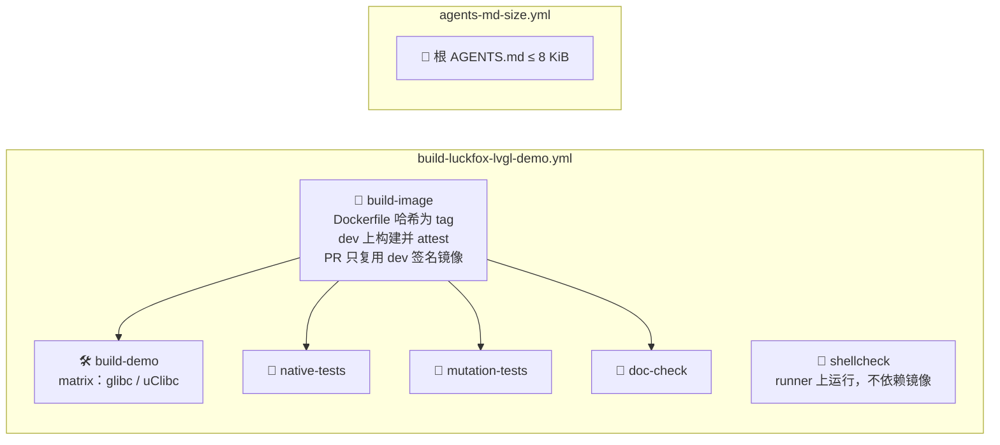
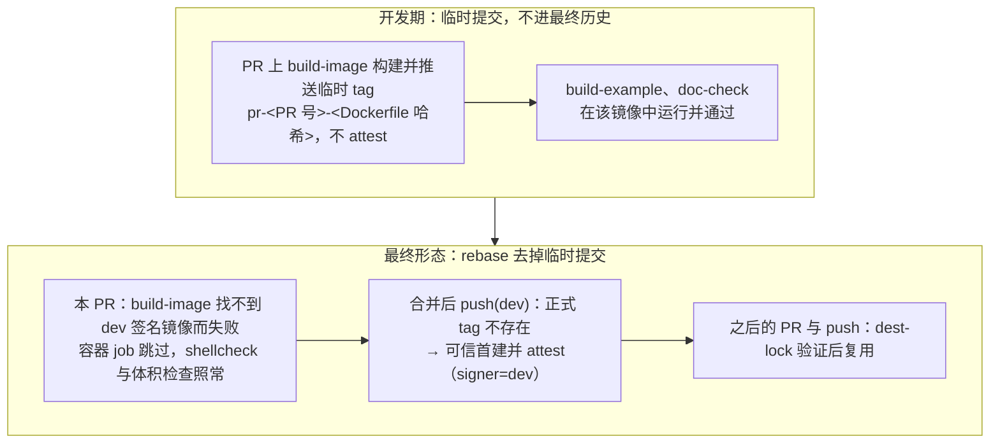
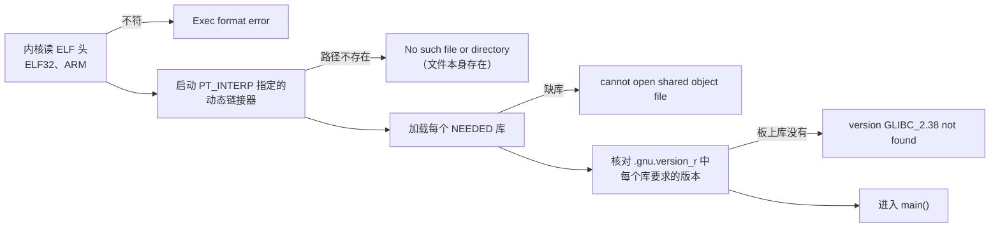
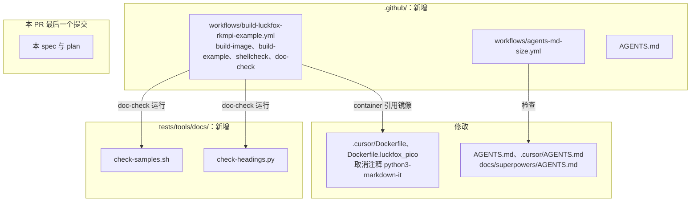
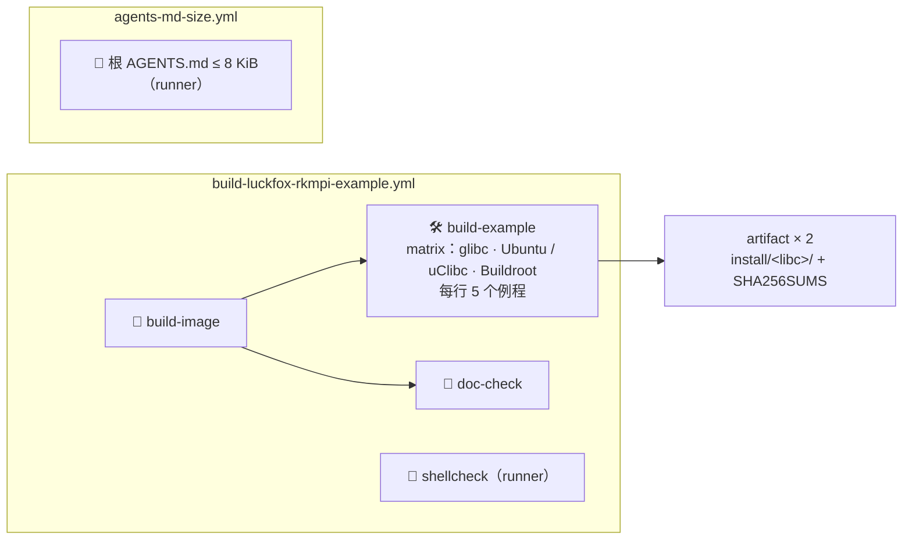

# Luckfox Pico RKMPI Example — GitHub Actions CI 设计规格

- **日期**：2026-11-17
- **状态**：已落地，V1–V5 通过，V6 待合并后在 `dev` 上核对，验证证据见 plan
- **分支**：`cursor/github-actions-ci-d6e2`（起点 `origin/dev` `e130684`，即 PR [#1](https://github.com/yuangezhizao/luckfox_pico_rkmpi_example/pull/1) 合入），开发期为草稿 PR
- **范围来源**：PR #1 spec [`2026-11-16-rkmpi-example-cloudagent-env-design.md`](2026-11-16-rkmpi-example-cloudagent-env-design.md) §7 路线图的第二项（两种 libc × 5 例程交叉编译、文档检查脚本入库与 job、取消注释 `python3-markdown-it`），以及该 spec Q7（检查脚本随 CI PR 入库）、Q11（体积预算由 CI PR 加检查）；PR #1 plan Task 8 的 V5、V6 在本 PR 的 Cloud Agent 中核对（§2.5）。作者要求优先参考 lvgl 仓，代码以其最新 `dev` 为准
- **参考实现**：lvgl 仓 [`dev` `11497f3`](https://github.com/yuangezhizao/luckfox_pico_lvgl_example/tree/11497f3d57d1e74eeade30a07e79a19c0f7f2369) 的 `.github/`：PR [#4](https://github.com/yuangezhizao/luckfox_pico_lvgl_example/pull/4)（首建 workflow：GHCR 镜像、provenance、两行 matrix）、[#12](https://github.com/yuangezhizao/luckfox_pico_lvgl_example/pull/12)（变体检验 job，本仓不适用）、[#14](https://github.com/yuangezhizao/luckfox_pico_lvgl_example/pull/14)（ShellCheck job）、[#16](https://github.com/yuangezhizao/luckfox_pico_lvgl_example/pull/16)（文档检查脚本入库与 job）、[#17](https://github.com/yuangezhizao/luckfox_pico_lvgl_example/pull/17)（体积检查 workflow 与 `.github/AGENTS.md`）；luckfox-pico 仓 [`dev` `665c7f1`](https://github.com/yuangezhizao/luckfox-pico/tree/665c7f10a132718ea2b9cb5fa25670c5197c9aba) 的固件 workflow：PR [#2](https://github.com/yuangezhizao/luckfox-pico/pull/2)（架构）、[#3](https://github.com/yuangezhizao/luckfox-pico/pull/3)（provenance 复用验证、强制重建、`persist-credentials: false`）、[#12](https://github.com/yuangezhizao/luckfox-pico/pull/12)（月度重建后编译、run 摘要）
- **关联计划**：[`../plans/2026-11-17-rkmpi-example-github-actions-ci.md`](../plans/2026-11-17-rkmpi-example-github-actions-ci.md)

---

## 1. 概述与目标

PR #1 补齐了 Cloud Agent 环境，但本仓仍没有 CI：交叉编译只在 Agent 或作者本机手动做，文档检查脚本要临时从 lvgl 仓克隆，根 `AGENTS.md` 的 8 KiB 预算只是文字约定。本 PR 按 lvgl 仓的做法新增 GitHub Actions，主要新增 `.github/`，另有文档检查脚本入库与几处说明更新（§3.1）。

目标：

1. 交叉编译 workflow：以 `.cursor/Dockerfile` 构建 GHCR 镜像（digest 引用、provenance 签名与复用验证），在其中按两种 libc 交叉编译全部 5 个例程，做兼容性检查（§2.6）后上传 artifact（§3.3、§3.4）。
2. ShellCheck job（§3.5）。
3. 文档检查脚本 `check-headings.py`、`check-samples.sh` 入库，新增 `📝 文档检查` job；两份 Dockerfile 取消注释 `python3-markdown-it`（§3.6、§3.8）。
4. 根 `AGENTS.md` 体积检查 workflow（§3.7）。
5. 新增 `.github/AGENTS.md`，更新根 `AGENTS.md`、`.cursor/AGENTS.md`、`docs/superpowers/AGENTS.md` 中「暂无 CI」「脚本尚未入库」的说法（§3.9）。
6. 记录 PR #1 遗留的 V5、V6 平台验证结果（§2.5）；PR #1 plan 的回填（Q12），以及 PR #1 的 spec 与 plan 删去与 `git log` 重复的提交清单（Q18），合为单独的一个提交。

**不在本规格范围**：测试（qemu 加载冒烟、原生单元测试、`build.sh` 行为测试等，§2.7）；修改 `CMakeLists.txt`、`build.sh`、例程源码与 `install/`，`build.sh` 的 ShellCheck 修复随它的测试放在后续 PR（Q9）；README 徽章；uClibc 工具链在 Build 期预装（PR #1 spec Q4）。

## 2. 背景

### 2.1 本仓现状与实测（2026-11-17）

在本 Cloud Agent（`.cursor/Dockerfile` 的镜像，8 核）中执行，命令见 plan 附录 A。

| 方面 | 现状 |
|---|---|
| `.github/` | 不存在；`gh api repos/yuangezhizao/luckfox_pico_rkmpi_example/actions/workflows` 为 0 个 |
| 构建入口 | `cmake` 须传 `LIBC_TYPE`、`EXAMPLE_DIR`、`EXAMPLE_NAME`，一次只构建一个例程；安装目录写死为源码树内 `install/<libc>/<例程>_demo/`，`install/` 已入库（20 个文件） |
| 安装内容 | 可执行文件与 `example/<例程>/model/` 下的模型文件，不含 `.so`；与已入库的 `install/` 结构相同 |
| 交叉编译 | 在仓库外的构建目录中依次构建两种 libc × 5 个例程：10 个全部成功，合计约 14 秒，编译输出 `warning:` 0 条；`make install DESTDIR=…` 后工作区无改动 |
| ABI | glibc：`NEEDED libc.so.6`，interpreter `/lib/ld-linux-armhf.so.3`，所需最高符号版本 `GLIBC_2.34`；uClibc：`NEEDED libc.so.0`，interpreter `/lib/ld-uClibc.so.0`；两者 RPATH 均为 `$ORIGIN/lib` |
| uClibc 工具链 | 稀疏检出 `yuangezhizao/luckfox-pico` `dev`（`665c7f1`）的 `tools/linux/toolchain`，约 4 秒、321 MB |
| shell 脚本 | `git ls-files '*.sh'` 共 3 个：`.cursor/install.sh`、`.cursor/start.sh` 的 ShellCheck（0.9.0）为 0 条；上游的 `build.sh` 为 6 条（SC2086 info 5 条、SC2164 warning 1 条） |
| 文档检查 | lvgl 仓 `check-headings.py`（markdown-it-py 3.0.0）检查本仓 2 个文件，问题 0 处；PR #1 spec 的 QA 已是 `**Q1. …**` 连续编号，本仓不需要 QA 豁免 |
| 根 `AGENTS.md` | 8,157 字节，距 8 KiB 预算（8,192 字节）只剩 35 字节 |
| Actions 版本 | 各 action 的最新 release：`actions/checkout` v7.0.1、`docker/login-action` v4.8.0、`actions/attest` v4.2.2、`actions/upload-artifact` v7.0.2，与 lvgl 仓 `dev` 所用的主版本相同 |

### 2.2 参考实现

lvgl 仓 `dev` 的 `.github/`：

| lvgl 仓 | 内容 | 本仓处理 |
|---|---|---|
| `build-image` | GHCR `luckfox-lvgl-demo-ci`，tag 取 `.cursor/Dockerfile` 内容哈希前 32 位；`dev` 上构建并 `actions/attest`；复用前 `gh attestation verify` 把 signer 与 source 锁定为 `dev`；`pull_request` 只复用，不构建、不推送；`schedule` 与 `force_rebuild` 无缓存重建 | 照搬，镜像名改为本仓（Q11）；加 luckfox-pico PR #12 的 run 摘要（Q6） |
| `build-demo` | matrix 两行，各编一个程序；uClibc 行稀疏检出工具链；`readelf` 门禁、`SHA256SUMS`、上传 artifact | 每行构建 5 个例程（Q3）；artifact 按 `install/<libc>/` 上传（Q4）；门禁扩展为 §2.6 的兼容性检查（Q5、Q15） |
| `native-tests`、`mutation-tests` | 原生测试、变体检验 | 不适用，本仓暂无测试（PR #1 spec §2.5） |
| `shellcheck` | runner 上对 `git ls-files` 列出的脚本执行 `shellcheck -x -P SCRIPTDIR`，要求 0 条 | 照搬，`build.sh` 的处理见 Q9 |
| `doc-check` | 容器中运行 `check-headings.py`、`check-samples.sh` | 照搬（Q7）；样例改写见 Q8 |
| `agents-md-size.yml` | 单独的 workflow，改了根 `AGENTS.md` 时检查不超过 8,192 字节 | 照搬（Q10） |
| `.github/AGENTS.md` | CI 的 gotcha | 按本仓改写（§3.9） |

luckfox-pico 仓与 lvgl 仓的差异：没有 `pull_request` 触发；PR #12 起月度 `schedule` 重建镜像后也编译固件，并把触发事件、分支、镜像来源与 digest 写入 `$GITHUB_STEP_SUMMARY`，事件名与分支名经 `env` 传入、不直接插入脚本。

### 2.3 首个镜像从哪里来

最终形态下 `pull_request` 只复用 dev 签名的镜像，而本仓 GHCR 中还没有任何镜像，所以本 PR 的 CI 中 `build-image` 必然失败，依赖它的容器 job 都被跳过，只剩 `shellcheck` 与体积检查运行；不另想办法，合并前就验证不到交叉编译与文档检查 job。

- lvgl 仓 PR #4 首测时允许 PR 构建并推送正式 tag，留下了 signer 为 `refs/pull/4/merge` 的 attestation；之后改为 PR 只复用，正式 tag 已被 PR 签名占用，合并后要在 `dev` 上 `force_rebuild` 重签（lvgl 仓 PR #4 plan §7）。
- lvgl 仓 PR #14、#16 改 Dockerfile 时，开发期临时在 runner 上 apt 安装，CI 通过后用 rebase 改回容器形态，最终历史中不出现临时步骤（lvgl 仓 PR #16 spec §3.1、§5）。

本 PR 的做法见 Q2、Q14；按推荐答案的流程：

### 2.4 官方文档要点（2026-11-17 读取）

- **fork 的 workflow**：GitHub 在新 fork 中默认不运行 workflow，要在 Actions 页点「I understand my workflows, go ahead and enable them」（[GitHub Docs](https://docs.github.com/en/code-security/how-tos/find-and-fix-code-vulnerabilities/configure-code-scanning/configure-code-scanning)）。本 fork 此前没有 workflow；本 PR 首次推送后两个 workflow 均为 `active`，PR 上自动触发（plan §5.5）。
- **scheduled workflow**：公开仓库被 fork 时 scheduled workflow 默认禁用；公开仓库 60 天无活动时自动停用（[Disabling and enabling a workflow](https://docs.github.com/en/actions/how-tos/manage-workflow-runs/disable-and-enable-workflows)）。luckfox-pico 仓同为 fork，2026-08 至 11 月的 schedule 都已触发（luckfox-pico 仓 11-03 spec §1.3）。
- **job 容器的用户**：Actions 要求 job 容器以超级用户运行；镜像末尾是 `USER ubuntu`，容器 job 用 `options: --user 0`（[Dockerfile support](https://docs.github.com/en/actions/reference/workflows-and-actions/dockerfile-support#user)）。
- **板端 Ubuntu 版本**：Luckfox 提供的 Ubuntu 固件是 Ubuntu 22.04（[Pico Pro/Max 镜像下载](https://wiki.luckfox.com/Luckfox-Pico/Luckfox-Pico-RV1106/Luckfox-Pico-Pro-Max/Luckfox-Pico-SD-Card-burn-image/)），其 glibc 为 2.35；官方论坛称已不再维护 Ubuntu 镜像（[论坛](https://forums.luckfox.com/viewtopic.php?t=1957)）。glibc 产物在板上运行的前提见 §2.6。

### 2.5 PR #1 遗留的 V5、V6（2026-11-17）

本 Agent 是本 fork 合并 PR #1 后首次启动的 Cloud Agent，按 PR #1 plan Task 8 核对：

| 项 | 结果 |
|---|---|
| saved environment | `environment-info`：`source` 为 `Repository`，`recordedVia` 为 `REPO_FILE_OBSERVED`，`environmentJsonPath` 为 `.cursor/environment.json`，location 已自动指向该文件 |
| V5 首个 Build | `bld-20261117-38df8078-…` 为 `SUCCEEDED`；日志中 `openssh-server` `1:9.6p1-3ubuntu13.20` 安装、host key 生成，末尾 `[INSTALL] Exit code: 0` |
| V6 用户与 grilling | `whoami` 为 `ubuntu`（uid 1000）；`~/.cursor` 为 `ubuntu:ubuntu 755`，`skills/`、`grilling/` 为 `750`，`SKILL.md` 为 `644`，SHA-256 `10ff989e…`，与 PR #1 plan §5.4 相同 |
| V6 Tailscale | `tailscale status` 的本机主机名为 `cursor-agent-for-luckfox-pico-rkmpi-example-d224f711`；`tailscale serve status` 有 1054、1055、5901；sshd 监听 22 |
| V6 构建 | 按根 `AGENTS.md` 的命令完成两种 libc × 5 个例程（§2.1） |
| V6 tailnet SSH | 作者 11-18 从本地 Mac mini 执行 `ssh ubuntu@<主机名>` 登录成功：解析到 `100.80.47.85`（本机 `tailscale ip -4`），ED25519 主机指纹 `SHA256:NIkgzOYEaIZnUN5IjJIjviYG8KsJWaJ2nMLoRMZR11c` 与本机 `/etc/ssh/ssh_host_ed25519_key.pub` 相同，本机 `last` 记录了来自 `100.64.20.2` 的这次登录。`ssh root@<主机名>` 被拒，报 `Permission denied (publickey)`；本机 `sshd -T` 为 `permitrootlogin no`（`start.sh` 写入并在启动时断言）、`passwordauthentication no` |

### 2.6 兼容性检查（作者在 Q5 中追问，2026-11-18）

兼容性检查不运行程序，只读 ELF 头与动态段，确认板上的内核和动态链接器能加载产物、产物要的东西板上都有。程序在板上启动时依次经过下面几关，每关对应一项检查：

| 检查 | 看什么 | 不满足时板上的表现 |
|---|---|---|
| 格式 | `readelf -h` 的 Class 为 ELF32、Machine 为 ARM | `Exec format error` |
| 动态链接器 | `PT_INTERP`：glibc 为 `/lib/ld-linux-armhf.so.3`，uClibc 为 `/lib/ld-uClibc.so.0` | 报 `No such file or directory`，容易误以为文件没传上去 |
| libc | `NEEDED`：glibc 行有 `libc.so.6` 且没有 `libc.so.0`，uClibc 行相反 | 在另一套固件上缺库 |
| 版本要求 | `readelf -V` 的 Version needs：每个库要求的最高版本不超过板上库提供的版本 | 报 ``version `GLIBC_2.38' not found``，程序不启动 |

**超过板上版本是否一定无法运行**：是。动态链接器在执行程序的任何代码之前核对 `.gnu.version_r` 中的全部版本要求，任一项板上库不提供就报错退出，与引用它的函数会不会被调用无关；只有标为 weak 的版本要求例外，常规编译不会生成。实测（plan 附录 A.3）：用 CI 同款交叉工具链编译只调用 `sscanf`、`strtol` 的小程序，产物要求 `GLIBC_2.38`：glibc 2.38 起在 `_GNU_SOURCE` 下把这两个函数重定向到 `__isoc23_*`，而 g++ 默认定义 `_GNU_SOURCE`。在 qemu 中用 Ubuntu 22.04 的 armhf libc 运行，报 ``./t: /lib/arm-linux-gnueabihf/libc.so.6: version `GLIBC_2.38' not found (required by ./t)``，退出码 1；不调用它们的程序正常输出。例程代码以后只要用到这类函数就会踩中，编译不报任何告警。

反过来，检查通过也不保证能运行：例程依赖的 Rockchip 库（`librkaiq.so`、`librga.so.2`、`librknnmrt.so` 等）由固件提供，部署目录中没有（§2.1），它们的版本、摄像头与 NPU 只能在真机验证。

版本上限取自 Ubuntu 22.04 `jammy-updates` 的 armhf 包；CI 工具链来自 Ubuntu 24.04，能产生超过上限的版本要求：

| 库 | 板上提供的最高版本 | 当前产物所需最高（CI 构建与入库的 `install/` 相同） | 24.04 交叉工具链可产生的最高版本 |
|---|---|---|---|
| `libc.so.6` | `GLIBC_2.35`（libc6 2.35-0ubuntu3.18） | `GLIBC_2.34` | `GLIBC_2.39` |
| `libstdc++.so.6` | `GLIBCXX_3.4.30`、`CXXABI_1.3.13`（libstdc++6 12.3.0） | `GLIBCXX_3.4.29`（yolov5，其余 3.4.21）、`CXXABI_1.3.9` | `GLIBCXX_3.4.33`、`CXXABI_1.3.15` |
| `libgcc_s.so.1` | `GCC_7.0.0` | `GCC_3.5` | — |

uClibc 行不设上限：Buildroot 固件的 libc、libstdc++ 与 CI 用的是同一套 SDK 工具链，产物要求的版本（`GLIBCXX_3.4.21`、`CXXABI_1.3.8`）由它提供。

### 2.7 本仓还能做哪些测试（作者在 Q1 中追问，2026-11-18）

在 PR #1 spec §2.5 的基础上，结合本次读代码与实测：

| 测试 | 证明什么 | 依赖与要点 |
|---|---|---|
| qemu 加载冒烟 | 产物的 `.so` 全部解析、进入 `main()` | `qemu-user`；glibc 行应使用 Ubuntu 22.04 的 armhf 运行库（§2.6 的做法），用 24.04 的交叉 sysroot（glibc 2.39）会掩盖版本问题；uClibc 行用 SDK 的 sysroot。只证明加载，不证明功能 |
| 后处理原生单元测试 | yolov5 的 `postprocess.cc`（518 行：框解码、NMS、反量化）、retinaface 的 `retinaface.cc`（先验框解码）对固定输入输出正确 | 主机 g++ 编译，打桩 RKNN 的类型；可加 ASan、UBSan；工作量最大，需评估 |
| 变体检验（mutation） | 单元测试能发现代码被改坏 | 随单元测试，同 lvgl 仓 PR #12 |
| `build.sh` 行为测试 | 用桩 `cmake`、`make` 放进 `PATH`，从标准输入喂选项，断言传给 `cmake` 的参数 | 可覆盖读脚本时发现的两点：`./build.sh clean` 会删除已入库的 `install/`；例程目录按当前目录判断，不在仓库根目录运行时报「目录不存在」（实测）。与 `build.sh` 的 ShellCheck 修复一起做（Q9） |
| CMake 配置测试 | 未设工具链变量时只打印 WARNING、不生成目标；`LIBC_TYPE` 的取值与安装路径 | 只跑 `cmake`、不编译，秒级；可与 `build.sh` 测试合并 |
| 入库产物的检查 | 入库的 10 个二进制通过 §2.6 的检查；`install/` 中的模型与 `example/<例程>/model/` 相同（实测 6 处都相同） | 无额外依赖，成本最低 |
| 静态分析 | cppcheck、clang-tidy，或把编译告警作为门禁（当前 0 条） | 与根 `AGENTS.md`「编译告警只记录、不作门禁」相冲突，需作者决定 |

## 3. 设计（以 §8 QA 结论为准）

### 3.1 新增与修改的文件

作者判断「主要包含 `.github` 文件夹」成立：新增内容以 `.github/` 为主；`tests/tools/docs/` 的两个脚本与 Dockerfile 的一行是 PR #1 spec Q7 定下随 CI PR 一起做的，三份 `AGENTS.md` 更新 CI 与检查的说法（§3.9）。

### 3.2 workflow 结构与触发

文件 `.github/workflows/build-luckfox-rkmpi-example.yml`，显示名「构建 Luckfox Pico RKMPI 例程」（Q11）。触发、并发与 lvgl 仓相同：`workflow_dispatch`（`force_rebuild`）、`schedule` `0 0 1 * *`、`push`（`dev`，`paths-ignore: '**.md'`）、`pull_request`（`dev`，无路径过滤）；`concurrency.group` 含 `event_name`；与 lvgl 仓不同，只有 `pull_request` 取消同组旧 run，其余事件排队（Q21）。

| 事件 | `build-image` | `build-example`、`doc-check` | `shellcheck` |
|---|---|---|---|
| `push`（`dev`，忽略只改 `**.md`） | tag 已存在则 dest-lock 验证后复用，不存在则可信构建并 attest | 运行 | 运行 |
| `pull_request`（`dev`） | 只复用 dev 签名镜像，tag 不存在或验证失败即失败 | 镜像可用时运行 | 运行 |
| `workflow_dispatch` | `dev` 上同 `push`，勾选 `force_rebuild` 时无缓存重建；非 `dev` 分支只能复用，需要强制重建或首建时报错退出（Q19） | 镜像可用时运行 | 运行 |
| `schedule` | 无缓存重建并 attest | 运行，用刚重建的镜像（Q6） | 跳过 |

所有 job：`runs-on: ubuntu-24.04`，按 job 设最小 `permissions`，`actions/checkout` 一律 `persist-credentials: false`；容器 job 以 `container.credentials`（`github.actor` + `GITHUB_TOKEN`）拉取 digest，`options: --user 0`。

### 3.3 `build-image`

以 lvgl 仓 `dev` 的同名 job 为底，逐字保留 `assert_digest`、`dest_lock_or_die`、按事件分流、buildx metadata 取 digest、新建时 `actions/attest@v4` 的逻辑，只改：

- 镜像名 `ghcr.io/<小写 owner>/luckfox-rkmpi-example-ci`；`--signer-workflow` 指向本 workflow 文件（Q11）。
- 按 luckfox-pico 仓 PR #12 写 run 摘要：触发事件、分支、镜像来源（强制重建、复用、首建）、完整镜像引用；事件名与分支名经 `env` 传入（Q6）。
- 注释中的「spec D12」「§9」指 lvgl 仓 PR #4 spec，本仓没有该文件，在 job 开头写明出处与完整链接。
- 强制重建与首建两条路径在推送前检查 `GITHUB_REF` 为 `refs/heads/dev`，否则报错退出；复用路径与 `pull_request` 路径不变（Q19）。lvgl 仓与 luckfox-pico 仓没有这层守卫。

### 3.4 `build-example`

- `needs: build-image`；`schedule` 也运行（Q6）；`timeout-minutes: 30`；`permissions`：`contents: read`、`packages: read`。
- matrix 两行，`fail-fast: false`：`glibc · Ubuntu`（只设 `GLIBC_COMPILER=/usr/bin/arm-linux-gnueabihf-`）、`uClibc · Buildroot`（只设 `LUCKFOX_SDK_PATH` 为稀疏检出的 `yuangezhizao/luckfox-pico` `dev`，跟随 `dev` HEAD、日志打印 SHA，同 lvgl 仓 PR #4 spec D8）。每行在一个 job 中依次构建 5 个例程（Q3）。
- 构建：先删除检出中的 `install/<libc>/`，再对每个例程（取 `example/` 下的目录，新增例程不用改 workflow）`cmake -S . -B build/<例程> …`、`make -j`、`make install`，使 `install/<libc>/` 只含本次构建的产物；某个例程失败时继续构建其余例程，最后列出失败的例程并以非 0 退出；每个例程的输出放在 `::group::` 中。CI 检出是一次性的，`make install` 改写其中已跟踪的 `install/` 不影响仓库（根 `AGENTS.md` 的 `DESTDIR` 约定针对 Agent 的工作区）。
- 兼容性检查（每个可执行文件，§2.6、Q5、Q15）：`test -s`；`readelf -h` 为 ELF32、ARM；glibc：`NEEDED libc.so.6`、interpreter `/lib/ld-linux-armhf.so.3`、不含 `libc.so.0`，且 `readelf -V` 的 Version needs 中 `GLIBC_`、`GLIBCXX_`、`CXXABI_`、`GCC_` 各自的最高版本不超过 `2.35`、`3.4.30`、`1.3.13`、`7.0.0`，上限写在 workflow 的 `env` 中、注释写明出处；uClibc：`NEEDED libc.so.0`、interpreter `/lib/ld-uClibc.so.0`、不含 `libc.so.6`，不查版本上限（Buildroot 固件的库与 SDK 工具链同源，Q17）。失败时打印超限的版本与引用它的符号。步骤名按行显示为「✅ 兼容性检查（含版本上限）」与「✅ 兼容性检查（uClibc 不查版本上限）」。
- `SHA256SUMS`：放在 `install/<libc>/` 中，对全部文件（可执行文件与 `model/` 下的模型）按相对路径排序计算；lvgl 仓的部署目录只有一层、用 `-maxdepth 1`，本仓有子目录，改为递归（Q4）。
- artifact：每行一个，`install/<libc>/` 整个目录，名称 `luckfox_pico_rkmpi_example_<libc>-<rootfs>_on-ubuntu-24.04`，`if-no-files-found: error`，保留期用默认的 90 天（Q4、Q11）。

### 3.5 `shellcheck`

照搬 lvgl 仓：runner 上直接运行，不依赖 `build-image`，`schedule` 跳过；`shellcheck -x -P SCRIPTDIR`，默认级别（含 style），要求 0 条。文件列表为 `git ls-files -z '*.sh'` 去掉上游的 `build.sh`，即 `.cursor/install.sh`、`.cursor/start.sh`、`tests/tools/docs/check-samples.sh`；排除写在 job 中一处，修复 `build.sh` 的后续 PR 删去这一处（Q9、Q13）。

### 3.6 文档检查脚本与 `doc-check`

- 路径与 lvgl 仓相同：`tests/tools/docs/check-headings.py`、`tests/tools/docs/check-samples.sh`，可执行位（Q8）。
- `check-headings.py`：以 lvgl 仓 `dev` 的文件为底，只改 `QA_EXEMPT` 为空字典，文档字符串与注释中指向 lvgl 仓文档的路径（PR #11 spec、PR #16 spec）改为 lvgl 仓的完整链接；其余逐字相同，以后 lvgl 仓修改检查器时按 diff 同步。
- `check-samples.sh`：内联的 `bad`、`ok` 样例照搬；16 个 `mk` 样例改写 lvgl 仓 4 份历史文档生成，改为取本仓文档（Q8）：
  - 样例按 lvgl 仓 PR #11 spec 的题号分组（脚本注释中的 `Q16`、`Q17` 等指该 spec，不是本 spec）。
  - 本仓文档中有对应原文的规则保留 `mk` 写法，取已合入的 PR #1 plan：Task 标题编号（`q17a`–`q17f`，改写 `### Task 1：`、`### Task 2：`、`### Task 7：`）与引用不存在的 Task（`q19a`，改写 `（Task 7）`）；另加一个 QA 编号样例，把 PR #1 spec 的 `**Q2. ` 改为 `**Q3. `。
  - 本仓文档中没有对应原文的规则改写为内联 `bad` 样例：`####` 末级编号（`q16a`–`q16d`，本仓文档没有四级标题）、章标题中的 Task 范围（`q24a`–`q24d`，PR #1 plan 的 `## 4. Tasks` 不带范围）、表格中的 Task 号（`q19b`）。
  - `mk` 断言被替换的原文存在、不存在时以 2 退出（与 lvgl 仓相同），以后修改 PR #1 的文档时样例会明确报错，不会静默失效；开头注释写明取用的两份文档。Q12 对 PR #1 plan 的回填不触及这些原文。
- `doc-check` job 照搬 lvgl 仓：容器 job，`needs: build-image`，依次运行 `python3 tests/tools/docs/check-headings.py` 与 `bash tests/tools/docs/check-samples.sh`，每次完整运行（Q7）。

### 3.7 `agents-md-size.yml`

照搬 lvgl 仓：单独的 workflow，`push`（`dev`）与 `pull_request`（`dev`）中改了根 `AGENTS.md` 时触发，runner 上运行，超过 8,192 字节时失败；报错信息中的 spec 指针改为 PR #1 spec Q11 与 lvgl 仓放置原则的链接（Q10）。

### 3.8 两份 Dockerfile

- `.cursor/Dockerfile` 与 `.cursor/Dockerfile.luckfox_pico` 取消注释「文档检查」组的 `python3-markdown-it`，组名注释去掉「本仓暂不安装」；RUN 上方的分组说明改写为本仓用途（`check-headings.py` 依赖，CI 的 `📝 文档检查` 与本地检查），头部「四组」改为「三组」。
- 两份镜像的版本：`ubuntu:24.04` 为 3.0.0-2（Python 3.12），`luckfox_pico:1.0`（Ubuntu 22.04）为 1.1.0-2（Python 3.10）；lvgl 仓 PR #16 已在两种版本下验证同一检查器（lvgl 仓 PR #16 spec §2.2），本 PR 在两份镜像中重跑（§4）。
- 改动使 `.cursor/Dockerfile` 的内容哈希变化；本仓还没有任何 CI 镜像，不影响复用。

### 3.9 `AGENTS.md`

- **`.github/AGENTS.md`**（新增）：按 lvgl 仓的结构写本仓内容：CI 只证明交叉编译与兼容性检查通过，不能代替真机；两行 matrix 各只设一个工具链变量、每行 5 个例程；artifact 与已入库 `install/` 的关系（CI 产物由当前镜像的工具链编译，与入库二进制不逐字节相同，`install/` 仍只在作者要求时更新）；CI 镜像只在 `dev` 上构建并 attest，非 `dev` 分支手动触发只能复用（Q19），改 `.cursor/Dockerfile` 的 PR 在合并前 `build-image` 必然失败、容器 job 被跳过；dest-lock 报缺少签名时的恢复方法，以及 `dev` 上的 run 排队而不互相取消的原因（Q21）；各 job 的要点；版本上限的出处与调整方法（§2.6）；fork 的 schedule 与 60 天停用。CI 的触发范围与「同一 PR 的新推送会取消 CI」写在根文件，此处不重复（每条事实只在一处写完整，lvgl 仓 PR #17 spec §3.3.1）。
- **根 `AGENTS.md`**：按 lvgl 仓 PR #17 spec（[`2026-11-01-lvgl-example-agents-md-slim-design.md`](https://github.com/yuangezhizao/luckfox_pico_lvgl_example/blob/11497f3d57d1e74eeade30a07e79a19c0f7f2369/docs/superpowers/specs/2026-11-01-lvgl-example-agents-md-slim-design.md)）的放置原则（§3.1）改写「测试与检查」（Q16）：
  - ShellCheck 与文档检查都已由 CI 强制，根文件只写命令。
  - 加一条所有任务都用得到的 CI 常识（该 spec §2.6 第 2 条）：CI 的触发范围、新推送会取消正在运行的 CI、改 `.cursor/Dockerfile` 的 PR 上 `build-image` 必然失败。
  - 去向表加一行「改 workflow、排查 CI 失败 → `.github/AGENTS.md`」。
  - 为留在 8,192 字节内，删去与本文件其他位置重复的内容：「改 shell 脚本跑 ShellCheck」、两处与去向表重复的 `.cursor/AGENTS.md` 指针、上游仓库名后重复的链接、一处重复的「Cloud Agent 自带的」；另删去指向 PR #1 spec 路线图的链接（历史 spec 只在确有需要时引用，该 spec §2.5；后续测试的候选见本 spec §2.7、§7）（Q10）。
- **`.cursor/AGENTS.md`**：「注释组」一条的「四组」改为三组并去掉文档检查组；「CI」一条改为指向 `.github/AGENTS.md`，写明镜像 tag 取 `.cursor/Dockerfile` 内容哈希。
- **`docs/superpowers/AGENTS.md`**：「检查」一条改为 lvgl 仓的写法：在仓库根目录运行入库的 `check-headings.py`，修改检查器时再运行 `check-samples.sh`，CI 的 `📝 文档检查` 运行两者；写明 `mk` 样例改写 PR #1 的 spec 与 plan，修改其原文时同步调整样例。

### 3.10 不做的事

- 不改 `CMakeLists.txt`、`build.sh`、例程源码、`lib/`、`include/`、`install/`。
- 不在 CI 中运行 ARM 二进制（qemu 加载冒烟属后续 PR）；不比较 CI 产物与已入库的二进制。
- 不加 README 徽章、不发布 Release。
- 不 pin uClibc 工具链的提交（同 lvgl 仓 PR #4 spec D8；Codex 安全审查的建议见 Q20）。

## 4. 验证

| 编号 | 验证 | 方式 |
|---|---|---|
| V1 | 静态检查 | `actionlint`（仓库外下载的二进制，内含 ShellCheck）对两个 workflow 0 条；本 spec §3.5 的文件列表 ShellCheck 0 条；`check-headings.py` 检查全部 spec 与 plan 为 0 处，`check-samples.sh` 不符合 0 个；根 `AGENTS.md` 不超过 8,192 字节 |
| V2 | 本机镜像 | 当前 VM 临时安装 Docker（`.cursor/AGENTS.md`「核对镜像内容」），构建两份镜像：`python3-markdown-it` 已安装，两个文档检查脚本通过；在 `.cursor/Dockerfile` 的镜像中以 `--user 0` 运行 `build-example` 的脚本，两行都通过门禁 |
| V3 | 门禁的反例 | 本地对 uClibc 产物运行 glibc 门禁、对 glibc 产物运行 uClibc 门禁都应失败；调用 `sscanf` 的小程序（`GLIBC_2.38`，§2.6）与引用 `GLIBCXX_3.4.31` 以上符号的小程序，版本门禁都应失败并打印超限的版本 |
| V4 | 开发期 CI | 按 Q2 的临时提交推送：全部 job 通过；两个 artifact 的文件清单与 `SHA256SUMS` 正确；另推一个改坏 spec 标题的临时提交，`📝 文档检查` 失败；run 编号记入 plan |
| V5 | 最终形态 CI | rebase 去掉临时提交后：`build-image` 因无 dev 签名镜像失败，容器 job 跳过；`🐚 ShellCheck` 与 `📏` 体积检查通过 |
| V6 | 合并后 | `push(dev)` 走可信首建并 attest；下一次 PR 走 dest-lock 复用。由下一个 PR 记录，不在本 PR 记为通过 |
| V7 | PR #1 的 V5、V6 | §2.5；tailnet SSH 由作者从另一台机器执行 |

## 5. 提交与 PR

- 分支 `cursor/github-actions-ci-d6e2`，PR 指向 fork 的 `dev`，开发期为草稿；先推送 spec 与 plan。
- 提交按主题拆分（Dockerfile、检查脚本、各 workflow、`AGENTS.md`），具体以 `git log` 为准；对 PR #1 spec 与 plan 的修改（Q12、Q18）合为单独的一个提交；spec 与 plan 放在最后一个提交，开发期最先推送，最终用 rebase 移到末尾。
- Q2 的临时提交只在开发期存在，验证后用 rebase 删去，最终历史中不出现（运行记录见 plan §5.5）。
- 合并前精简 plan，只保留未入库的内容：验证证据、偏离、合并后步骤与可复用的命令。

## 6. 风险

- **workflow 被停用**：本 fork 的 workflow 已启用（§2.4）；以后若在 Actions 页被停用，PR 上不会出现检查，需要作者重新启用。
- **改 `.cursor/Dockerfile` 的 PR 不跑容器 job**：与 lvgl 仓相同；这类 PR 上交叉编译与文档检查要等合并后的 `push(dev)`，或按 Q2 的临时提交在开发期验证。
- **临时 tag 留在 GHCR**：Q2 的 `pr-…` tag 不被任何复用路径信任，合并后可在包页面删除。
- **schedule 停用**：fork 与 60 天无活动都会停用 schedule（§2.4）；停用时 `gh workflow enable` 或在 Actions 页启用，与 luckfox-pico 仓 11-03 spec §7 R2 相同的取舍。
- **uClibc 工具链跟随 `dev`**：两次 run 可能用不同提交，日志打印 SHA。
- **版本上限**：取自 Ubuntu 22.04 `jammy-updates` 的 armhf 包（§2.6）；板上固件若是更早的 22.04 快照，libc6、libstdc++6 的版本号不同，但 22.04 内不会改变所提供的符号版本；作者若改用其他 glibc 系统，按该系统的包调整 `env` 中的上限。CI 的交叉工具链维持 24.04（Q17），以后代码引用超限的符号时 CI 失败、而不是产出不能运行的产物；不便在代码中避开时按 Q17 的 B 切换到 22.04 工具链。
- **`build.sh` 暂不在 ShellCheck 范围内**：后续 PR 修复并加测试后纳入（Q9、Q13）。
- **`build-image` 使用第三方 Action**：`docker/login-action@v4` 是可变标签，运行在能推送并签名镜像的 job 中；被篡改时恶意代码在合法的 `dev` 签名上下文中运行，dest-lock 拦不住。在与两仓一起改为脚本内 `docker login --password-stdin` 之前接受这一风险（Q22）。

## 7. 后续

各项单独一个 PR，候选与要点见 §2.7：

- `build.sh`：修复 6 条 ShellCheck（第 3、52–56 行加引号，`cd` 失败时退出），加行为测试，并决定 `clean` 删除已入库 `install/`、只能在仓库根目录运行两处是否修改；ShellCheck job 删去对它的排除（Q9）。
- qemu 加载冒烟：取消注释 `qemu-user`，glibc 行用 Ubuntu 22.04 的 armhf 运行库（PR #1 spec §2.5、本 spec §2.6）。
- 后处理原生单元测试与变体检验（需评估，PR #1 spec §7）。
- 合并后核对 V6（§4），记入下一个 PR。

跨仓事项，随 lvgl 仓以后的 PR 处理：

- lvgl 仓 `check-samples.sh` 的 `q16a`–`q16d` 不能单独证明四级标题编号规则（plan §5.4），已在[本 PR 的评论](https://github.com/yuangezhizao/luckfox_pico_rkmpi_example/pull/2#issuecomment-6982065802)中给出建议。
- lvgl 仓的 spec、plan 与 PR 正文也逐条列出提交标题，作者决定暂时观望（Q18）。
- 三仓的 `build-image` 去掉 `docker/login-action`，改为脚本内登录（Q22），三仓一起改。
- lvgl 仓与 luckfox-pico 仓的 workflow 同步本 PR 的 dev 分支守卫（Q19）与「只有 `pull_request` 取消旧 run」（Q21），两仓一起改；两仓的对应位置已在[本 PR 的评论](https://github.com/yuangezhizao/luckfox_pico_rkmpi_example/pull/2#issuecomment-7029039009)中列出。

## 8. QA（grilling 记录）

问句与推荐取自问答原文，「答」是作者回答经润色后的版本。第 1 轮 12 问（Q1–Q12）于 11-17 提出、11-18 回答；第 2 轮 3 问（Q13–Q15）由作者对 Q1、Q2、Q5 的追问引出，11-18 回答。第 3 轮 3 问（Q16–Q18）由作者 11-19 的复查提问引出，当天回答；Q19–Q22 由 PR 改为 ready 后 Codex 的代码审查与安全审查意见引出。

**Q1. PR 范围**

- 问：A 只做交叉编译 workflow 与 `.github/AGENTS.md`；B 在 A 之外按 PR #1 spec §7、Q7、Q11 一并做 ShellCheck job、文档检查脚本入库与 `📝 文档检查` job、Dockerfile 取消注释 `python3-markdown-it`、根 `AGENTS.md` 体积检查；C 在 B 之外再做 qemu 加载冒烟（取消注释 `qemu-user`）。
- 推荐：B。正是 PR #1 路线图中这一个 PR 的范围；qemu 冒烟只能证明加载、不能证明功能，单独一个 PR 更好评估。
- 答：范围按 B。作者追问除 qemu 冒烟外还能做哪些测试，整理在 §2.7，都不放进本 PR；另问 `build.sh` 不在本 PR 修复时 ShellCheck 能否整体放到之后的 PR，见 Q13。

**Q2. 首个镜像与合并前的验证**

- 问：本仓 GHCR 还没有镜像，最终形态下本 PR 的容器 job 都会被跳过（§2.3）。A 开发期加一个临时提交：PR 上构建并推送临时 tag `pr-<PR 号>-<Dockerfile 哈希>`（不 attest），容器 job 用它运行；验证通过后 rebase 删去，正式 tag 保持空白，合并后的 `push(dev)` 走可信首建。B 同 lvgl 仓 PR #4：临时允许 PR 推送正式 tag，合并后在 `dev` 上 `force_rebuild` 重签。C 不在 PR 上运行容器 job，只在本机 Docker 中模拟，合并后看 `dev` 的 CI。
- 推荐：A。合并前全部 job 在真实 runner 上跑过一次；正式 tag 从未被非 dev 签名占用，合并后不需要人工重签；临时 tag 不被任何复用路径信任。
- 答：A 可以；作者另提出「开发期间不校验签名，验证完在合并前用 rebase 加回」，问选哪个，见 Q14。

**Q3. matrix 的形状**

- 问：A 两行（glibc、uClibc），每行依次构建 5 个例程；B 十行（libc × 例程），每行一个例程。
- 推荐：A。10 个例程合计只需约 14 秒（§2.1），每个 job 的主要开销是拉取约 1 GB 的 CI 镜像；两行与 lvgl 仓、README「先选 libc」的流程一致；例程失败时继续构建其余例程、最后汇总，每个例程的日志分组显示，失败定位不比十行差。
- 答：按推荐 A。

**Q4. artifact 的内容**

- 问：A 每行一个 artifact，内容为 CI 重新生成的 `install/<libc>/`（5 个部署目录）加覆盖其中全部文件的 `SHA256SUMS`；B 每个例程一个 artifact（共 10 个）；C 不上传，只做门禁。
- 推荐：A。与已入库的 `install/<libc>/` 结构相同，README「将部署文件夹完整上传到板上」可直接照做；两个 artifact 比十个好找；模型文件只有几 MB。
- 答：按推荐 A，参考 lvgl 仓的构建产物：artifact 就是部署目录本身，`SHA256SUMS` 放在其中，名称 `<名称>_<libc>-<rootfs>_on-<os>`，与之相同；本仓部署目录有 `model/` 子目录，`SHA256SUMS` 改为递归覆盖（§3.4）。

**Q5. ABI 门禁**

- 问：A 同 lvgl 仓：ELF32、ARM、`NEEDED` 中有本行的 libc 且没有另一套；B 在 A 之外检查 interpreter，并要求 glibc 产物引用的最高 `GLIBC_` 符号版本不超过 `2.35`（Luckfox 的 Ubuntu 22.04 固件，§2.4）。
- 推荐：B。CI 镜像的交叉工具链来自 Ubuntu 24.04（glibc 2.39），目前的产物只需 `GLIBC_2.34`；以后例程代码或工具链升级可能引入更高版本的符号，板上会报 `version 'GLIBC_2.xx' not found`，门禁能在 CI 中提前发现；检查只多几行 `objdump -T`。
- 答：作者追问兼容性检查是什么、glibc 超过 2.35 是否一定无法运行。解释与实测见 §2.6：超过即无法启动；核对时发现 libstdc++ 有同样的问题，检查范围改为在 Q15 中确定，版本要求改用 `readelf -V` 读取（动态链接器核对的就是这一节）。

**Q6. 月度 schedule 与 run 摘要**

- 问：A 同 lvgl 仓，月度只重建镜像、跳过编译；B 同 luckfox-pico 仓 PR #12，重建后用新镜像运行 `build-example` 与 `doc-check`，并在 `build-image` 中写 run 摘要（事件、分支、镜像来源、digest）。
- 推荐：B。编译只需约 1 分钟，新镜像当月就被验证，apt 更新弄坏工具链时失败出现在 schedule 上、不会落到无关的提交；artifact 每月刷新，不会因 90 天保留期过期而没有可下载的产物；摘要可从 artifact 所在 run 追溯镜像。
- 答：按推荐 B。作者问重建频率：与 lvgl 仓、luckfox-pico 仓相同，每月 1 日北京时间 08:00（`0 0 1 * *`）。每周能更快吸收 apt 安全更新，但 run 与 GHCR 中的镜像版本约多四倍；本仓镜像只用于编译与检查，按月足够。

**Q7. `📝 文档检查` 在哪里运行**

- 问：A 同 lvgl 仓，容器 job（`needs: build-image`），版本与 Cloud Agent 相同，改 Dockerfile 的 PR 上被跳过；B runner 上直接运行，用 runner 预装的 `python3-markdown-it`（lvgl 仓 PR #16 实测为 3.0.0-2），不依赖镜像。
- 推荐：A。CI 与 Cloud Agent 用同一个包、同一个版本；runner 预装的包不受本仓控制，镜像更新时可能变化；改 Dockerfile 的 PR 很少，与其他容器 job 一同跳过可以接受。
- 答：按推荐 A，在 CI 容器中运行。

**Q8. 检查脚本的移植方式**

- 问：路径与 lvgl 仓相同（`tests/tools/docs/`），`check-headings.py` 只改 `QA_EXEMPT` 与指向 lvgl 仓文档的路径（§3.6）。`check-samples.sh` 的 16 个 `mk` 样例改写 lvgl 仓 4 份历史文档生成：A 改写为覆盖同一规则的内联样例；B 删去，只保留内联样例；C 改用本仓 PR #1 的 spec 与 plan 生成。
- 推荐：A。保留全部规则的回归覆盖；C 会把本仓历史文档冻结为样例的前提，且 PR #1 plan 已精简、可替换的原文不多。
- 答：不取 lvgl 仓的文档，可以取本仓的文档，即 C。本仓文档中有对应原文的规则用 PR #1 的 spec 与 plan 生成，没有的改为内联样例（§3.6）；`mk` 在原文不存在时以 2 退出，修改这两份文档时样例会明确报错，不会静默失效。

**Q9. ShellCheck 与上游的 `build.sh`**

- 问：`build.sh` 有 6 条（§2.1）。A job 的文件列表排除 `build.sh`；B 修复这 6 条；C 在 `build.sh` 中加 `# shellcheck disable` 注释。
- 推荐：A。`build.sh` 是上游文件，本仓不改它以便同步上游（PR #1 spec §3.1）；根 `AGENTS.md` 的 ShellCheck 要求针对新增或修改的脚本；以后修改 `build.sh` 的 PR 再修复并纳入。
- 答：需要修复，但同意本 PR 先按 A 排除；修复放在新的 PR，与 `build.sh` 的测试一起（§7）。作者问修复工作量：6 条集中在第 3、52–56 行，都是变量加引号与 `cd` 失败时退出，约 5 行，路径不含空格时行为不变；工作量主要在测试（§2.7）。

**Q10. 根 `AGENTS.md` 的预算与体积检查**

- 问：根文件只剩 35 字节，指向 CI 的句子与去向表一行放不下。A 保持 8 KiB：CI 的细节写进 `.github/AGENTS.md`，根文件只改一句、加一行，压缩其他措辞（不删信息），并照搬 lvgl 仓的体积检查 workflow；B 放宽预算（如 10 KiB）；C 不加体积检查。
- 推荐：A。与 lvgl 仓一致（其根文件 7,916 字节）；PR #1 spec Q11 已定下保留 8 KiB、由 CI PR 加检查。
- 答：按推荐 A。

**Q11. 命名**

- 问：workflow 文件 `build-luckfox-rkmpi-example.yml`，显示名「构建 Luckfox Pico RKMPI 例程」；镜像 `ghcr.io/yuangezhizao/luckfox-rkmpi-example-ci`；job 名 `🛠️ glibc · Ubuntu`、`🛠️ uClibc · Buildroot`；artifact `luckfox_pico_rkmpi_example_glibc-ubuntu_on-ubuntu-24.04`、`luckfox_pico_rkmpi_example_uclibc-buildroot_on-ubuntu-24.04`。是否可以。
- 推荐：按上述命名，与 lvgl 仓（`build-luckfox-lvgl-demo.yml`、`luckfox-lvgl-demo-ci`）、luckfox-pico 仓（`build-luckfox-pico-firmware.yml`）的风格一致；artifact 前缀取仓库名，与 lvgl 仓取程序名的做法对应（本仓有 5 个程序）。
- 答：按推荐。

**Q12. PR #1 遗留的 V5、V6 怎么记录**

- 问：PR #1 plan Task 8 写明结果记入下一个 PR。A 结果记在本 spec §2.5，PR #1 plan Task 8 的勾选项改为已完成并加一句指向本 spec；tailnet SSH 两项由作者从另一台机器执行后回填。B 只记在本 spec，不改 PR #1 plan。
- 推荐：A。PR #1 plan 中未勾选的项会让人以为仍待验证；只改勾选与一句指针，不改其他历史内容。
- 答：按推荐 A；对 PR #1 plan 的修改放在本 PR 单独的提交中（§5）。

**Q13. ShellCheck job 在本 PR 还是之后的 PR 引入**

- 问：作者在 Q1 中提出，`build.sh` 不在本 PR 修复时，ShellCheck 是否整体放到之后的 PR。A 本 PR 引入，排除 `build.sh`，修复它的 PR 删去排除；B 整个 job 随 `build.sh` 的修复在之后的 PR 引入。
- 推荐：A。另外 3 个脚本（`.cursor/install.sh`、`.cursor/start.sh` 与本 PR 新增的 `check-samples.sh`）已是 0 条，本 PR 起就能防止退化；排除只在 job 中写一处，之后删去即可；选 B 时这 3 个脚本在此期间只靠本地检查。
- 答：按推荐 A。

**Q14. 开发期验证：临时 tag 还是临时不校验签名**

- 问：A 即 Q2 的推荐：临时提交让 PR 上的 `build-image` 构建并推送 `pr-<PR 号>-<Dockerfile 哈希>` tag，不 attest，后续 job 用它；D 作者提出：临时提交去掉签名校验，验证完用 rebase 恢复。两者在开发期都不校验签名，差别在镜像推到哪个 tag：D 若推到正式 tag（Dockerfile 哈希），该 tag 上没有 dev 签名，合并后 `push(dev)` 发现 tag 已存在、dest-lock 验证失败，按设计不回退，要在 `dev` 上手动 `force_rebuild` 重签，即 lvgl 仓 PR #4 的情形（§2.3）；D 若推到另一个 tag，就与 A 相同。
- 推荐：A。正式 tag 在合并前保持空白，合并后的 `push(dev)` 自动走可信首建，不需要人工重签；临时提交只为 `pull_request` 新增一条构建临时 tag 的路径，不改 `assert_digest`、`dest_lock_or_die` 等校验函数，删去临时提交后的校验代码就是开发期跑过的那份；临时 tag 不被任何复用路径信任。
- 答：按推荐 A。

**Q15. 兼容性检查的范围**

- 问：A 即 Q5 的推荐：ELF32、ARM、interpreter、libc，加 `GLIBC_` 不超过 2.35；B 在 A 之外对 glibc 行加 libstdc++、libgcc_s 的版本上限（`GLIBCXX_3.4.30`、`CXXABI_1.3.13`、`GCC_7.0.0`，§2.6）；C 在 B 之外加 `NEEDED` 白名单，只允许 libc 套件与固件提供的 Rockchip 库，出现其他库即失败。
- 推荐：B。24.04 交叉工具链的 libstdc++ 能产生 `GLIBCXX_3.4.33`，超过板上的 3.4.30，与 glibc 是同一类问题（§2.6）；四个上限放在 `env` 中，用同一段检查代码。C 的白名单要随例程的链接库一起维护，而缺库时板上的报错直接写出库名，比版本问题好查，暂不做。
- 答：按推荐 B。

**Q16. 四份 `AGENTS.md` 是否符合 lvgl 仓 PR #17 的原则**

- 问：作者在 [yuangezhizao/luckfox_pico_lvgl_example#17](https://github.com/yuangezhizao/luckfox_pico_lvgl_example/pull/17) 中重写了这些文件，要求对照那次的原则与依据检查本 PR 新增与修改的四份 `AGENTS.md`，有问题直接在对应提交中修改。
- 推荐：对照该 PR 的 spec（放置原则 §3.1、内容问题 §2.6、维护规则 §3.3.1），根文件有四处问题，在对应的提交中修改：
  - 缺少所有任务都用得到的 CI 常识：触发范围、新推送会取消 CI、改 Dockerfile 的 PR 上 `build-image` 必然失败（§2.6 第 2 条），lvgl 仓根文件有，本 PR 只写了一个指向。
  - 文档检查已由 CI 强制，按放置原则根文件应直接写命令，而不是指向子目录文件。
  - CI 触发范围写在只在改 workflow 时才读的 `.github/AGENTS.md`。
  - 几处指针与去向表重复。
  - `.cursor/AGENTS.md`、`docs/superpowers/AGENTS.md` 与 lvgl 仓同构，没有问题；`.github/AGENTS.md` 只有触发范围一条与根文件重复。
- 答：按推荐，在对应的提交中直接修改（§3.9）。

**Q17. CI 应使用哪个版本的交叉工具链**

- 问：作者指出 `build-example` 的容器（`.cursor/Dockerfile`，Ubuntu 24.04）正是兼容性检查所说「能产生更高版本要求」的来源，问 CI 应该用哪个版本，以及 Buildroot 与 Ubuntu 两种板子是否都受限。
  - **受限范围**：只有 glibc 产物（Ubuntu 固件）受限。uClibc 产物用 SDK 的工具链编译，与 Buildroot 固件出自同一套，版本检查只在 glibc 行执行（§2.6）。
  - **实测**：在基于 Ubuntu 22.04 的 `.cursor/Dockerfile.luckfox_pico` 镜像中，交叉工具链为 gcc 11.4、glibc 2.35，5 个 glibc 例程都能编译并通过检查；交叉 libstdc++ 的上限正好是 `GLIBCXX_3.4.30`。§2.6 中调用 `sscanf`、`strtol` 的程序在其中只要求 `GLIBC_2.34`；调用 `std::chrono::current_zone()` 的程序直接编译报错，问题从「板上无法启动」变成「编译失败」。
- 选项：
  - A 维持现状：CI 镜像与 Cloud Agent 相同，glibc 行靠兼容性检查拦截超限的版本要求；在 workflow 的注释中写明 uClibc 行不做版本检查及原因。
  - B glibc 行改用 Ubuntu 22.04 的交叉工具链，产物天然不超过板上版本，兼容性检查保留作保险。实现方式二选一：
    - CI 另构建并签名 `Dockerfile.luckfox_pico` 的镜像，作为 glibc 行的容器；`build-image` 的复用验证要处理两个镜像。
    - Cloud Agent 与 CI 都切换到该镜像。它的 FROM `luckfoxtech/luckfox_pico:1.0` 自 2023 年后没有更新，比 lvgl 仓所用的 `ubuntu:24.04` 旧。
- 推荐：A。当前产物都在上限内，检查能把「板上无法启动」提前为 CI 中带符号名的失败；B 的第一种实现要多维护一个签名镜像，且 Cloud Agent 本地编译仍用 24.04，与 CI 的结果不一致；第二种把开发环境换到不再更新的旧镜像。将来检查真的被触发、又不便在代码中避开时，再按 B 切换，上面的实测说明切换可行。
- 答：按推荐 A。兼容性检查步骤的 `env` 注释写明上限只用于 glibc 行及原因；作者另问能否在标题中体现，步骤名改为按行显示「✅ 兼容性检查（含版本上限）」与「✅ 兼容性检查（uClibc 不查版本上限）」，固定标题会让 uClibc 行看起来也查版本上限（`.github/AGENTS.md` 同步）。

**Q18. spec、plan 与 PR 正文是否记录提交标题**

- 问：PR #1、本 PR 的 spec、plan 与 PR 正文都逐条列出了提交标题，plan 的落地指针写成「提交 N」。作者认为这些已在 git 中，可以像精简 plan 那样移除，问 lvgl 仓是否也这样写、怎么看。lvgl 仓从 [yuangezhizao/luckfox_pico_lvgl_example#12](https://github.com/yuangezhizao/luckfox_pico_lvgl_example/pull/12) 起的 PR 正文都有「提交」表，PR #14、#16、#17 等的 plan 与部分 spec 也逐条列出。
- 推荐：移除标题清单与「提交 N」的编号指针，只保留 git 看不出的部分：拆分方式、PR #1 plan 的修改单独一个提交、spec 与 plan 放在最后一个提交、开发期的临时提交与其运行记录。标题、顺序与签名以 `git log` 为准；清单与历史重复，每次改写历史都要同步，本 PR 已因此改过多次。PR #1 的 spec 与 plan 同样处理，PR 正文的「提交」一节改为一两句；lvgl 仓的 PR 较多，暂不处理。
- 答：同意，本仓两个 PR 都改；lvgl 仓暂时观望。作者随后要求把 PR #1 文档的这次修改与 Q12 的回填合为一个提交：两者都只改历史文档。

**Q19. 是否在 `build-image` 加 dev 分支守卫**

- 问：Codex 审查（P1）指出：在非 `dev` 分支手动触发并勾选 `force_rebuild`，或 tag 不存在走首建时，`build-image` 不检查 ref，会用 feature 分支签名推送正式 tag；之后 `dev` 与 PR 的 dest-lock 拒绝复用，容器 job 一直跳过，直到在 `dev` 上强制重建。核实属实：只影响可用性，dest-lock 不会信任 feature 签名的镜像，不是安全问题；`pull_request` 路径只复用、不推送。lvgl 仓 [yuangezhizao/luckfox_pico_lvgl_example#4](https://github.com/yuangezhizao/luckfox_pico_lvgl_example/pull/4) 收到过同样的意见（P2），当时回复缺口存在、修不修是策略选择、要修就与 luckfox-pico 仓一起修，最终没有修；luckfox-pico 仓在 11-03 spec §6 写成「只在 `dev` 上勾选」的操作规则。本仓文档只写了 `force_rebuild`，漏了首建路径：在 feature 分支改了 Dockerfile 再手动触发，就会踩到。A 本 PR 在两条构建路径前检查 `refs/heads/dev`，非 `dev` 时报错退出、不推送，复用路径不变；B 不改代码，与两仓保持一致，文档补上首建路径。
- 推荐：A。约 5 行，堵住日常容易踩到的坑，「CI 镜像只在 dev 上构建并 attest」由代码保证；非 `dev` 分支手动触发、复用已有镜像来测试的做法不受影响，三仓都是如此；两仓的同步记为后续事项（§7）。
- 答：按推荐 A；在 Codex 的评论线程中回复处理结果。

**Q20. uClibc 工具链是否固定到 commit SHA**

- 问：Codex 安全审查（P2）建议把 `yuangezhizao/luckfox-pico` 的检出从 `dev` 改为固定的完整 commit SHA：每次运行都以 root 执行可变分支上的编译器并上传产物，打印 SHA、兼容性检查与 `SHA256SUMS` 都挡不住被植入的编译器。机制属实；前提是攻击者能写入该仓库的 `dev`。作者不打算固定。
- 推荐：不固定，维持 §3.10。lvgl 仓 PR #4 spec D8、Q8 已定为跟随 `dev`、日志打印 SHA；该仓库是作者自己的 fork，`dev` 有规则集保护，能写入它的主体与能写入本仓 `dev`、直接改 workflow 的是同一账户，固定之后升级仍由同一账户合入，信任根不变（同 luckfox-pico 仓 CI spec Q13）；`tools/linux/toolchain` 自上游首个提交 `00aee41`（2023-08-08）以来没有改动，跟随 `dev` 与固定拿到的内容相同。工具链来源改为第三方、该目录开始更新或 artifact 用于正式发布时，再改为固定 SHA。
- 答：按推荐；在评论线程中回复，不标记解决。

**Q21. 推送正式镜像后、签名前被自动取消**

- 问：Codex 代码审查（P2）指出：workflow 级 `cancel-in-progress: true` 会在同组新 run 到来时取消旧 run；`build-image` 先在构建步骤末尾推送正式 tag，下一步才 `actions/attest`，取消落在两者之间会留下没有 attestation 的正式 tag，之后同一 Dockerfile 的 run 都走复用路径、在 dest-lock 失败，直到在 `dev` 上手动强制重建。核实属实：窗口只有签名耗时，lvgl 仓 `dev` 首建那次为 5 秒，且只在新建镜像时又恰好有同组触发；可恢复，但失败提示是「疑似复用投毒或验证服务不可用」，容易误判；lvgl 仓与 luckfox-pico 仓的并发设置相同，两仓都没有收到过这条意见。A 改为 `cancel-in-progress: ${{ github.event_name == 'pull_request' }}`：PR 只复用、不推送，取消安全；`dev` 推送、手动触发与 `schedule` 排队，等待中被更新的 run 替换时尚未开始，不碰镜像。B 把并发改到 job 级，`build-image` 不取消，下游 job 的并发组要带上 matrix 的 libc。C 在 `dev` 上 dest-lock 失败时自动重建：能自愈，但会悄悄覆盖真正的投毒，改变 fail loud 的设计。D 在 `.github/AGENTS.md` 写明缺少签名时的恢复方法。
- 推荐：A 与 D。一行改动，代价是 `dev` 上偶尔多跑一次约 2.5 分钟的 CI；两仓的同步与 Q19 一起记为后续事项（§7）。
- 答：按推荐；在评论线程中回复，并在 PR 评论区列出 lvgl 仓与 luckfox-pico 仓的对应位置。

**Q22. `docker/login-action` 是否固定到 commit SHA**

- 问：Codex 安全审查（P2）建议把 `build-image` 中的 `docker/login-action@v4` 固定到完整 commit SHA：`v4` 是可变标签，该 job 有 `packages: write`、OIDC 与 attestation 写权限，`GITHUB_TOKEN` 直接作为 password 传入；标签被篡改时恶意代码在合法的 `dev` signer 上下文中运行，dest-lock 拦不住。核实属实：workflow 的 4 个 Action 中只有它来自第三方；与 Q20 不同，它不在作者控制之下，「信任根相同」的理由不适用；lvgl 仓与 luckfox-pico 仓同样使用 `@v4`，两仓都没有讨论过 Action 的版本固定。A 去掉该 Action，在构建步骤开头用 `printf '%s' "${GH_TOKEN}" | docker login ghcr.io -u "${ACTOR}" --password-stdin` 登录（令牌仍由环境变量提供，经标准输入交给 docker，不出现在进程参数中），权限最高的 job 中不再有第三方代码；B 固定 SHA 并加 Dependabot；C 4 个 Action 全部固定。
- 推荐：A。
- 答：本 PR 不修改，以后三仓一起按 A 改（§7）；在评论线程中回复改法，不标记解决。
